<div dir="rtl">

# تقرير مشروع التخرج
## نظام إدارة الهوية والوصول والمصادقة (IAM Gateway)
### Identity and Access Management (IAM) and Authentication

---

## المحتويات

1. [المقدمة](#1-المقدمة)
2. [مشكلة البحث](#2-مشكلة-البحث)
3. [أهداف المشروع](#3-أهداف-المشروع)
4. [نطاق المشروع وحدوده](#4-نطاق-المشروع-وحدوده)
5. [الإطار النظري](#5-الإطار-النظري)
6. [منهجية التطوير](#6-منهجية-التطوير-sdlc)
7. [تحليل المتطلبات](#7-تحليل-المتطلبات)
8. [تصميم النظام](#8-تصميم-النظام)
9. [التنفيذ: كيف تحقّق كل جانب من IAM](#9-التنفيذ-كيف-تحقق-كل-جانب-من-iam) (9.6 وحدات الأعمال)
10. [تحليل التهديدات والضوابط الأمنية](#10-تحليل-التهديدات-والضوابط-الأمنية)
11. [البيانات التجريبية](#11-البيانات-التجريبية)
12. [الاختبار](#12-الاختبار)
13. [القيود والتطوير المستقبلي](#13-القيود-والتطوير-المستقبلي)
14. [الخلاصة](#14-الخلاصة)
15. [المراجع](#15-المراجع)

---

## 1. المقدمة

مع تحوّل المؤسسات إلى الأنظمة الرقمية أصبحت **الهوية** هي خط الدفاع الأول؛ فمعظم الاختراقات لا تبدأ بكسر التشفير، بل بسرقة كلمة مرور أو استغلال حساب يملك صلاحيات أكثر من حاجته أو حساب موظف غادر ولم يُعطَّل. **إدارة الهوية والوصول (IAM)** هي مجموعة السياسات والتقنيات التي تضمن أن **الشخص الصحيح** يصل إلى **المورد الصحيح** في **الوقت الصحيح** و**للسبب الصحيح**، مع إمكانية إثبات ذلك لاحقاً.

يقدّم هذا المشروع بوابة ويب متكاملة (**IAM Gateway**) لمؤسسة افتراضية واقعية هي «شركة الرافدين للحلول التقنية» في بغداد، تدير هويات 23 موظفاً موزعين على 7 أقسام، وتتحكم في وصولهم إلى **12 وحدة أعمال حقيقية** (الإجازات، ملفات الموظفين والرواتب، فواتير الموردين، المصروفات، العملاء والصفقات، تذاكر الدعم، أجهزة تقنية المعلومات، الإعلانات، دليل الموظفين، مكتبة المستندات)، وتسجّل كل حدث أمني وكل عملية أعمال في سجل تدقيق.

## 2. مشكلة البحث

في كثير من المؤسسات المحلية تُدار الحسابات بشكل يدوي ومتفرق، ما يؤدي إلى:

- **كلمات مرور ضعيفة أو مخزّنة كنص صريح**، ولا يوجد عامل تحقق ثانٍ؛ فسرقة كلمة مرور واحدة تعني اختراق الحساب.
- **صلاحيات زائدة**: الموظف يحصل على صلاحيات «احتياطاً» ولا تُسحب عند انتقاله لقسم آخر.
- **حسابات يتيمة**: موظفون غادروا وما زالت حساباتهم وجلساتهم فعّالة.
- **غياب المساءلة**: لا يمكن معرفة من دخل، ومن غيّر صلاحية، ومن حاول الوصول إلى ملف غير مسموح.
- **عدم القدرة على الاستجابة للحوادث**: لا توجد آلية لإنهاء جلسة مسروقة فوراً.

## 3. أهداف المشروع

1. بناء آلية **مصادقة قوية** تجمع بين «شيء تعرفه» (كلمة المرور) و«شيء تملكه» (تطبيق المصادقة TOTP).
2. تطبيق **التفويض المبني على الأدوار (RBAC)** بمبدأ **أقل الصلاحيات** و**الرفض الافتراضي**، مع **نطاق البيانات** (بياناتي/قسمي/الكل) و**قواعد العمل** و**الأمن على مستوى الحقل** على محتوى أعمال حقيقي.
3. إدارة **دورة حياة الهوية** كاملة: الانضمام، الانتقال، المغادرة (Joiner – Mover – Leaver).
4. إدارة **الجلسات والرموز** بأمان مع إمكانية الإلغاء الفوري وكشف سرقة الرموز.
5. توفير **سجل تدقيق** ولوحة مراقبة أمنية تكشف الهجمات (التخمين، رش كلمات المرور).
6. حماية التطبيق نفسه من هجمات الويب الشائعة (OWASP Top 10): الحقن، XSS، CSRF، Clickjacking.
7. إثبات صحة النظام باختبارات آلية.

## 4. نطاق المشروع وحدوده

**داخل النطاق:** تسجيل ذاتي بموافقة، تسجيل دخول بخطوتين، سياسة كلمات مرور، قفل الحساب، إدارة المستخدمين والأدوار والصلاحيات، إدارة الجلسات، سجل التدقيق وتصديره، لوحة مراقبة، **بوابة موظفين بـ 12 وحدة أعمال** تُطبَّق عليها الصلاحيات، اختبارات آلية.

**خارج النطاق (ممكن مستقبلاً):** الدخول الموحّد مع جهات خارجية (SSO عبر SAML/OpenID Connect)، الربط مع Active Directory/LDAP، إرسال البريد الإلكتروني لاستعادة كلمة المرور، مفاتيح الأمان المادية (WebAuthn/FIDO2).

## 5. الإطار النظري

### 5.1 الركائز الأربع لإدارة الهوية (IAAA)

| الركيزة | السؤال | مثال في المشروع |
|---|---|---|
| **Identification — التعريف** | من تدّعي أنك؟ | إدخال `omar.alani` |
| **Authentication — المصادقة** | أثبت ذلك | كلمة المرور + رمز TOTP |
| **Authorization — التفويض** | ماذا يُسمح لك أن تفعل؟ | هل يملك `resources:finance:read`؟ |
| **Accountability / Auditing — المساءلة** | ماذا فعلت؟ | سجل `audit_logs` |

### 5.2 عوامل المصادقة

- **شيء تعرفه:** كلمة المرور.
- **شيء تملكه:** الهاتف الذي يولّد رمز TOTP.
- **شيء أنت عليه:** البصمة (غير مطبّق، يدخل في التطوير المستقبلي عبر WebAuthn).

المصادقة متعددة العوامل (MFA) تعني أن المهاجم يحتاج إلى سرقة **عاملين من نوعين مختلفين**، وهو أصعب بكثير من سرقة كلمة مرور.

### 5.3 تجزئة كلمات المرور (Hashing) مقابل التشفير (Encryption)

- **التشفير** عملية عكسية (يمكن فك التشفير بالمفتاح) — استُخدم لسرّ TOTP لأن الخادم يحتاج قراءته (AES-256-GCM).
- **التجزئة** عملية باتجاه واحد — استُخدمت لكلمات المرور، فلا يستطيع حتى مدير النظام معرفة كلمة مرور أي موظف.
- **bcrypt** خوارزمية تجزئة **بطيئة عمداً** (cost = 12 أي 2¹² = 4096 جولة) وتضيف **ملحاً (Salt)** عشوائياً لكل كلمة مرور، فكلمتا مرور متطابقتان تعطيان تجزئتين مختلفتين، ويصبح هجوم القاموس وجداول Rainbow غير عملي.

### 5.4 كلمة المرور لمرة واحدة المبنية على الوقت — TOTP (RFC 6238)

يشترك الخادم والهاتف في **سرّ** (160 بت) عند المسح الضوئي لرمز QR. بعدها يحسب كل منهما الرمز باستقلالية:

1. `T = floor(الوقت الحالي بالثواني / 30)`
2. `HMAC = HMAC-SHA1(السر, T)`
3. **الاقتطاع الديناميكي**: أخذ 4 بايتات من موقع يحدده آخر نصف بايت ← عدد صحيح 31 بت
4. `الرمز = العدد mod 10^6` ← 6 أرقام

الرمز يتغير كل 30 ثانية ولا يُرسل السر عبر الشبكة أبداً. نُفّذت الخوارزمية **يدوياً** في `src/services/totp.js` (دون مكتبة جاهزة) وتم التحقق منها باختبار آلي يطابق **متجهات الاختبار الرسمية في RFC 6238**.

### 5.5 نماذج التحكم بالوصول

| النموذج | الفكرة | لماذا لم/لماذا اخترناه |
|---|---|---|
| DAC (تقديري) | مالك المورد يقرر | لا يناسب مؤسسة مركزية |
| MAC (إلزامي) | تصنيفات أمنية صارمة | معقد، للجهات العسكرية |
| **RBAC (حسب الدور)** | الصلاحيات تُمنح للأدوار، والأدوار للمستخدمين | **المختار**: يطابق الهيكل الوظيفي، سهل المراجعة |
| ABAC (حسب الخصائص) | قرارات حسب خصائص المستخدم والمورد والسياق | **مطبّق جزئياً فوق RBAC**: قواعد العمل تعتمد على خصائص السجل (المبلغ، المالك، القسم، الجمهور) |

### 5.6 المبادئ الأمنية المطبّقة

- **أقل الصلاحيات (Least Privilege):** المستخدم الجديد يحصل على دور «موظف» فقط.
- **الرفض الافتراضي (Default Deny):** أي مسار محمي يُرفض ما لم تُثبت الصلاحية.
- **فصل المهام (Separation of Duties):** مسؤولة الهويات تُسند الأدوار لكنها **لا تعدّل** صلاحيات الأدوار؛ المدقق يقرأ ولا يعدّل.
- **الدفاع في العمق (Defense in Depth):** عدة طبقات: Rate limit ← كلمة مرور ← MFA ← جلسة صالحة ← صلاحية ← تدقيق.
- **عدم الثقة الضمنية:** الصلاحيات تُقرأ من قاعدة البيانات مع **كل طلب** ولا يُعتمد على ما في الرمز.

### 5.7 رموز JWT ورموز التحديث

**JWT (JSON Web Token)** رمز موقّع رقمياً (HMAC-SHA256) يحتوي هوية المستخدم ومعرّف الجلسة وتاريخ الانتهاء. ميزته أن الخادم يتحقق منه دون قاعدة بيانات، وعيبه أنه **لا يمكن إلغاؤه** قبل انتهائه. لذا صُمّم النظام هجيناً:

- **Access Token** قصير العمر (15 دقيقة)، يُحفظ في **ذاكرة المتصفح فقط**.
- **Refresh Token** طويل العمر (7 أيام)، في **Cookie من نوع HttpOnly** لا تستطيع JavaScript قراءته، ولا يُخزّن في القاعدة إلا **بصمته SHA-256**.
- كل طلب يتحقق أيضاً من أن **الجلسة** المرتبطة بالرمز (`sid`) ما زالت فعّالة ← إنهاء الجلسة يوقف الوصول فوراً.

## 6. منهجية التطوير (SDLC)

اعتُمد **النموذج التكراري التزايدي (Iterative & Incremental)**: بُني النظام على مراحل، كل مرحلة تُضيف قدرة كاملة ثم تُختبر قبل الانتقال للتالية.

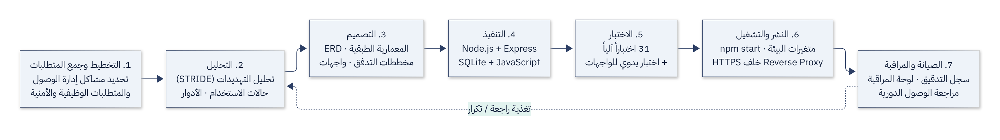

| المرحلة | المخرجات |
|---|---|
| 1. التخطيط وجمع المتطلبات | قائمة المتطلبات الوظيفية وغير الوظيفية (القسم 7) |
| 2. التحليل | الأدوار، حالات الاستخدام، تحليل التهديدات STRIDE (القسم 10) |
| 3. التصميم | المعمارية الطبقية، مخطط ERD، مخططات التدفق والتتابع، تصميم الواجهات |
| 4. التنفيذ | التكرار 1: قاعدة البيانات والمصادقة · التكرار 2: MFA والجلسات · التكرار 3: RBAC ودورة الحياة · التكرار 4: التدقيق ولوحة المراقبة والواجهات · التكرار 5: وحدات الأعمال مع النطاق وقواعد العمل وأمن الحقول |
| 5. الاختبار | 31 اختباراً آلياً + اختبار يدوي لكل الواجهات (القسم 12) |
| 6. النشر | `npm start`، الإعدادات عبر متغيرات البيئة |
| 7. الصيانة والمراقبة | لوحة المراقبة، سجل التدقيق، مصفوفة مراجعة الوصول الدورية |

## 7. تحليل المتطلبات

### 7.1 الجهات الفاعلة (Actors)

| الجهة | الدور في النظام | الوصف |
|---|---|---|
| الموظف | `employee` | يدخل، يدير حسابه وMFA، يصل إلى موارد قسمه |
| مسؤول الهويات | `iam_admin` | ينشئ الحسابات، يوافق، يعلّق، يُسند الأدوار |
| المدير العام | `super_admin` | يملك كل شيء ويعدّل سياسات الأدوار |
| المدقق الأمني | `security_auditor` | يقرأ السجلات ويصدّرها، لا يعدّل شيئاً |
| الدعم الفني | `it_support` | يفك القفل، يعيد تعيين كلمة المرور وMFA |
| موظف الموارد البشرية / المالية | `hr_manager` / `finance_officer` | يصل إلى ملفات قسمه فقط |
| زائر | — | يطلب إنشاء حساب فقط |

### 7.2 المتطلبات الوظيفية

| الرقم | المتطلب | مكان التنفيذ |
|---|---|---|
| FR-1 | التسجيل الذاتي بحالة «بانتظار الموافقة» ودور «موظف» | `routes/auth.js` → `/register` |
| FR-2 | تسجيل الدخول بكلمة المرور | `routes/auth.js` → `/login` |
| FR-3 | التحقق بخطوتين TOTP + رموز استرداد | `routes/auth.js` → `/mfa/verify`، `routes/mfa.js` |
| FR-4 | قفل الحساب بعد 5 محاولات فاشلة لمدة 15 دقيقة | `routes/auth.js` |
| FR-5 | سياسة كلمات مرور + منع إعادة استخدام آخر 5 | `services/password.js` |
| FR-6 | إنشاء حساب من المسؤول بكلمة مرور مؤقتة وإجبار تغييرها | `routes/users.js`، `middleware/auth.js` |
| FR-7 | الموافقة، التعليق، التعطيل، إعادة التفعيل | `routes/users.js` → `/:id/status` |
| FR-8 | إسناد الأدوار وتعديل صلاحيات الأدوار وإنشاء أدوار جديدة | `routes/users.js`، `routes/roles.js` |
| FR-9 | عرض الجلسات النشطة وإنهاؤها | `routes/sessions.js` |
| FR-10 | سجل تدقيق مع بحث وتصفية وتصدير CSV | `routes/audit.js` |
| FR-11 | لوحة مراقبة أمنية بالإحصاءات والرسوم | `routes/dashboard.js` |
| FR-12 | موارد محمية حسب القسم | `routes/dashboard.js` → `/resources/:category` |
| FR-13 | مصفوفة مراجعة الوصول ومصفوفة الصلاحيات × الأدوار | `routes/roles.js` → `/matrix` |
| FR-14 | الإجازات: تقديم، إلغاء، اعتماد حسب القسم أو للجميع، رصيد سنوي | `routes/apps/hr.js` |
| FR-15 | ملفات الموظفين مع حجب الراتب و IBAN على مستوى الحقل | `routes/apps/hr.js` |
| FR-16 | الرواتب: قسائمي، المسيّرات، الإعداد والاعتماد (Maker–Checker) | `routes/apps/hr.js` |
| FR-17 | فواتير الموردين بحدود اعتماد ومنع اعتماد ما سجّله الشخص | `routes/apps/finance.js` |
| FR-18 | المصروفات: تقديم واعتماد | `routes/apps/finance.js` |
| FR-19 | العملاء والصفقات بملكية السجل وإعادة الإسناد | `routes/apps/operations.js` |
| FR-20 | تذاكر الدعم: استلام، معالجة، إسناد، إغلاق | `routes/apps/operations.js` |
| FR-21 | الأجهزة والأصول وكشف أجهزة الموظفين المغادرين | `routes/apps/operations.js` |
| FR-22 | الإعلانات (عامة أو موجّهة لقسم) ودليل الموظفين والصفحة الرئيسية الشخصية | `routes/apps/hr.js`, `portal.js` |

### 7.3 المتطلبات غير الوظيفية

| النوع | المتطلب |
|---|---|
| الأمان | لا تُخزّن أي كلمة مرور أو رمز أو سرّ كنص صريح |
| الأداء | التحقق من الطلب < 5 ملّي ثانية (التجزئة البطيئة فقط عند الدخول) |
| قابلية الاستخدام | واجهة عربية بالكامل، رسائل خطأ واضحة |
| قابلية النقل | تشغيل بأمر واحد بدون خادم قاعدة بيانات |
| قابلية الصيانة | كل الإعدادات الأمنية في `src/config.js`، فصل الطبقات |
| قابلية الاختبار | اختبارات آلية بقاعدة بيانات مؤقتة مستقلة |

## 8. تصميم النظام

### 8.1 المعمارية

معمارية **ثلاثية الطبقات (3-Tier)**: طبقة العرض في المتصفح، طبقة التطبيق في Node.js، وطبقة البيانات في SQLite. داخل الخادم تُفصل **المسارات** عن **الخدمات** عن **الوصول إلى البيانات**، وتعمل الـ Middleware كنقطة **فرض السياسة (Policy Enforcement Point)** أمام كل مسار محمي.

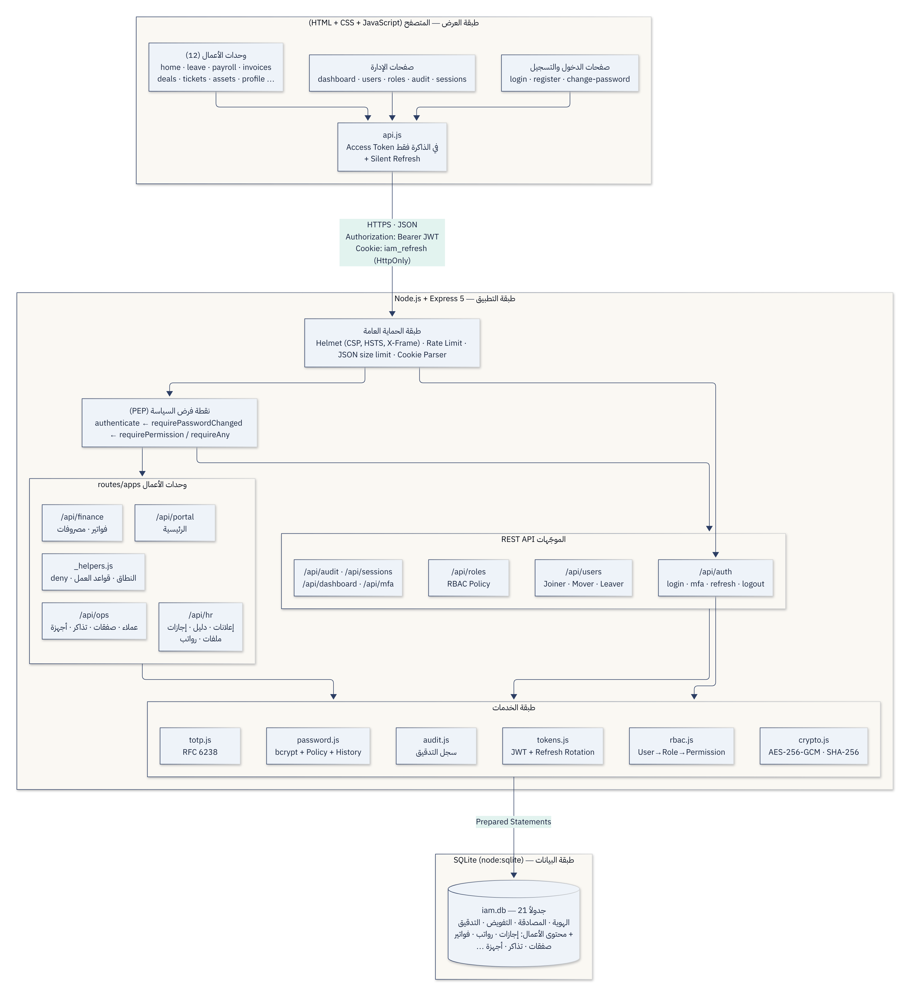

> جميع المخططات بصيغتها المصدرية (Mermaid) مع شرحها في [02-diagrams.md](02-diagrams.md).

### 8.2 قاعدة البيانات

21 جدولاً في خمس مجموعات: **الهوية** (departments, users, password_history, employee_profiles)، **المصادقة** (sessions, mfa_recovery_codes)، **التفويض** (roles, permissions, role_permissions, user_roles)، **المساءلة** (audit_logs)، و**المحتوى المحمي** (announcements, leave_requests, payroll_runs, payslips, invoices, expense_claims, customers, deals, tickets, assets, resources). كل جدول أعمال يحتوي عمود **ملكية** (`user_id`/`owner_id`/`assigned_to`/`created_by`) تعتمد عليه قواعد النطاق وفصل المهام. العلاقة بين المستخدمين والأدوار، وبين الأدوار والصلاحيات **كثير-إلى-كثير** عبر جداول وسيطة. التفاصيل في [04-database.md](04-database.md).

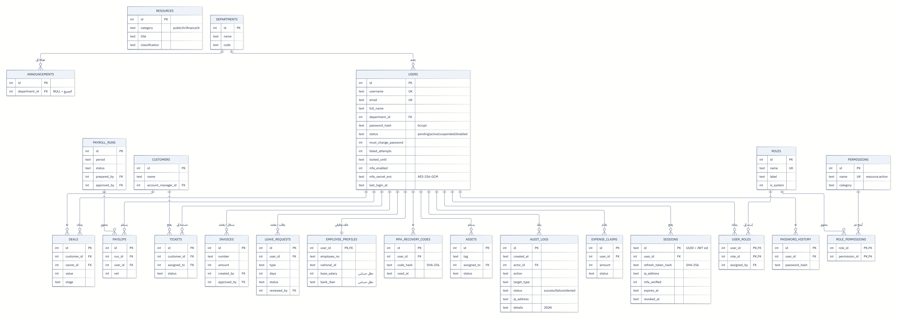

### 8.3 لماذا هذه التقنيات؟

| التقنية | السبب |
|---|---|
| **Node.js + Express** | لغة واحدة (JavaScript) للخادم والواجهة، نظام مكتبات أمنية ناضج (Helmet, rate-limit) |
| **SQLite** | قاعدة علائقية حقيقية بملف واحد، تدعم المعاملات والمفاتيح الأجنبية والفهارس، لا تحتاج تثبيت خادم — مثالية لمشروع يُسلَّم ويُشغَّل عند المشرف |
| **node:sqlite المدمج** | لا يحتاج ترجمة مكتبات أصلية (native build)، يعمل مباشرة على Windows/Linux/Mac |
| **JavaScript بدون أطر** | يوضح المفاهيم دون إخفائها خلف إطار عمل، وحجم صغير، ويسمح بسياسة CSP صارمة |
| **bcryptjs** | تجزئة كلمات المرور المعتمدة صناعياً |
| **jsonwebtoken** | توقيع والتحقق من JWT وفق RFC 7519 |
| **helmet** | ترويسات أمان HTTP (CSP, X-Frame-Options, nosniff, HSTS) |
| **express-rate-limit** | الحد من محاولات التخمين الآلية |
| **qrcode** | توليد رمز QR لربط تطبيق المصادقة |

## 9. التنفيذ: كيف تحقّق كل جانب من IAM

> الجولة المصوّرة الكاملة لكل الواجهات في [03-screens-walkthrough.md](03-screens-walkthrough.md).

### 9.1 التعريف (Identification)

- كل هوية لها `username` و`email` فريدان (قيد `UNIQUE COLLATE NOCASE` في القاعدة حتى لا يُسجَّل `Ali` و`ali` كحسابين).
- اسم المستخدم مقيّد بصيغة `^[a-z][a-z0-9._-]{2,31}$` لمنع الأسماء المضللة.
- الهوية مرتبطة بقسم ومسمى وظيفي، ما يسهّل مراجعة الوصول.

### 9.2 المصادقة (Authentication)

**أ) كلمة المرور** (`src/services/password.js`)
- تجزئة bcrypt بكلفة 12.
- سياسة: 10 أحرف على الأقل، حرف كبير وصغير ورقم ورمز، ليست ضمن قائمة كلمات المرور المسرّبة الشائعة، لا تحتوي اسم المستخدم أو البريد.
- **سجل كلمات المرور**: لا يمكن إعادة استخدام آخر 5 كلمات مرور.
- تُطبّق السياسة في **الخادم** (المرجع الحقيقي)، وتُعرض في الواجهة كقائمة تحقق حيّة لتحسين التجربة فقط.

**ب) الحماية من التخمين**
- **قفل الحساب** بعد 5 محاولات فاشلة لمدة 15 دقيقة (يشمل الرموز الخاطئة لـ MFA، فلا يمكن تخمين الأرقام الستة).
- **تحديد المعدل**: 30 طلب دخول/تسجيل/تحقق لكل عنوان IP كل 15 دقيقة.
- **رسالة خطأ موحدة** («اسم المستخدم أو كلمة المرور غير صحيحة») + **مقارنة bcrypt وهمية** للمستخدم غير الموجود، حتى يتساوى زمن الاستجابة ولا يستطيع المهاجم معرفة الأسماء الموجودة (منع **User Enumeration**).

**ج) المصادقة الثنائية TOTP** (`src/services/totp.js`, `src/routes/mfa.js`)
- **التسجيل**: يولّد الخادم سرّاً عشوائياً 160 بت ← يعرضه كرمز QR ← **لا يُفعَّل** حتى يُدخل المستخدم أول رمز صحيح (يضمن أن الهاتف مربوط فعلاً) ← يُصدر 8 **رموز استرداد** تُعرض مرة واحدة وتُخزّن كبصمات SHA-256، كل رمز يُستخدم **مرة واحدة**.
- **التخزين**: السر مشفّر بـ **AES-256-GCM** (تشفير مصادَق)، فلو سُرّب ملف القاعدة لا تُكشف أسرار MFA.
- **الدخول بخطوتين**: بعد كلمة المرور الصحيحة لا تُنشأ جلسة، بل يُعطى `challengeToken` صالح 5 دقائق ولا يصلح لأي شيء سوى خطوة التحقق.
- **إيقاف MFA** يتطلب كلمة المرور **و**رمزاً صالحاً.

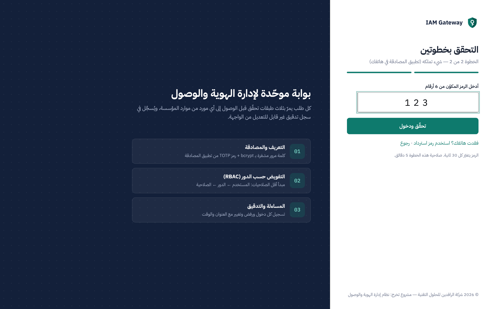

**د) الجلسات والرموز** (`src/services/tokens.js`)
- Access JWT (15 دقيقة، HS256، يحتوي `sub`, `sid`, `iss`, `exp`) في الذاكرة.
- Refresh Token في Cookie: `HttpOnly` (ضد XSS) + `SameSite=Strict` (ضد CSRF) + `Path=/api/auth` + `Secure` في الإنتاج.
- **التدوير (Rotation)**: كل استخدام لرمز التحديث يُصدر رمزاً جديداً ويُبطل القديم.
- **كشف إعادة الاستخدام**: إذا قُدّم رمز قديم (مُدوَّر) فهذا يعني أنه سُرق ← **تُلغى الجلسة كاملة** فوراً ويُسجّل الحدث `auth.refresh_token_reuse`.
- **الإلغاء الفوري**: تسجيل الخروج، تغيير كلمة المرور (يُنهي الأجهزة الأخرى)، إعادة التعيين، التعليق والتعطيل كلها تُلغي الجلسات، ولأن كل طلب يتحقق من الجلسة، يتوقف الوصول **في الطلب التالي** حتى لو كان الـ JWT ما زال صالحاً.

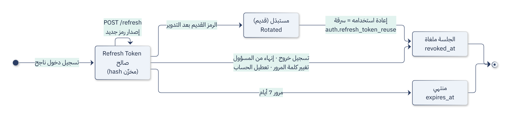

### 9.3 التفويض (Authorization)

**النموذج** (`src/services/rbac.js`): `مستخدم ← أدوار ← صلاحيات`، والصلاحيات بصيغة `مورد:إجراء` أو `مورد:إجراء:نطاق` (55 صلاحية في 15 دوراً). الصلاحيات الفعلية للمستخدم = **اتحاد** صلاحيات كل أدواره. أدوار الإدارة موضحة في الجدول التالي، وأدوار وحدات الأعمال في القسم 9.6.

| الدور | الصلاحيات الأساسية |
|---|---|
| `super_admin` | كل الـ 55 صلاحية |
| `iam_admin` | إدارة المستخدمين، إسناد الأدوار، الجلسات، قراءة التدقيق — **بدون** `roles:manage` و`audit:export` |
| `security_auditor` | قراءة فقط: المستخدمون، الأدوار، الجلسات، التدقيق + تصديره، الفواتير، المصروفات، الرواتب |
| `it_support` | فك القفل، إعادة تعيين كلمة المرور، كل الأجهزة وإدارتها |
| `employee` | الخدمة الذاتية: الإعلانات، الدليل، إجازاتي، قسائمي، مصروفاتي، أجهزتي، المستندات العامة |

**نقطة فرض السياسة** (`src/middleware/auth.js`):

```js
app.use('/api/audit', authenticate, requirePasswordChanged, auditRoutes);
router.get('/', requirePermission('audit:read'), handler);
```

- `authenticate`: يتحقق من التوقيع والانتهاء والجلسة وحالة الحساب، ثم **يحمّل الصلاحيات من القاعدة الآن** — فسحب دور يسري في الطلب التالي مباشرة (مُثبت باختبار آلي).
- `requirePermission`: رفض افتراضي؛ أي صلاحية ناقصة ← `403` + تسجيل `access.denied` مع الصلاحية الناقصة.

**قواعد منع تصعيد الصلاحيات** (`src/routes/users.js`):
- لا يمكن لأي مسؤول تعديل **أدواره هو** أو تغيير **حالة حسابه**.
- فقط `super_admin` يمنح دور `super_admin` أو يعدّل حساباً يملكه.
- صلاحيات `super_admin` ثابتة لا تُعدّل، وأدوار النظام لا تُحذف.

**في الواجهة:** القائمة الجانبية تُبنى من صلاحيات المستخدم، فالموظف لا يرى «سجل التدقيق» أصلاً. لكن هذا **تحسين للتجربة وليس أماناً**؛ فلو كتب العنوان يدوياً يحصل على صفحة 403 ويرفض الخادم طلب البيانات ويسجّله.

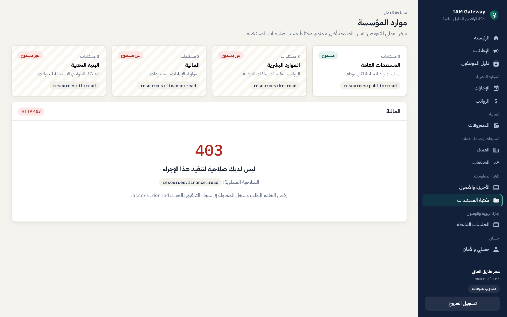

### 9.4 دورة حياة الهوية (Identity Lifecycle)

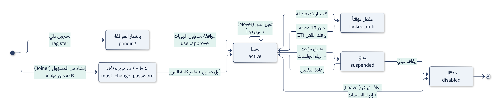

| المرحلة | التنفيذ |
|---|---|
| **Joiner — التسجيل الذاتي** | حساب `pending` + دور `employee` فقط، لا يستطيع الدخول حتى الموافقة |
| **Joiner — من المسؤول** | كلمة مرور مؤقتة عشوائية (14 حرفاً) تُعرض مرة واحدة، و`must_change_password = 1` يمنع أي استخدام للنظام قبل تغييرها |
| **Mover** | تعديل الأدوار يُسجَّل بما أُضيف وما حُذف، ويسري فوراً |
| **Leaver** | `disabled` ← إلغاء كل الجلسات فوراً، الحساب يبقى للتدقيق ولا يُحذف |
| **تعليق مؤقت** | `suspended` (مثلاً أثناء تحقيق) مع سبب يُحفظ في السجل |
| **فك القفل / إعادة التعيين** | من الدعم الفني، مع إنهاء الجلسات وإجبار تغيير كلمة المرور |

### 9.5 المساءلة والتدقيق (Accountability)

كل حدث يُسجَّل في `audit_logs` بالحقول: الوقت، المنفّذ (المعرّف والاسم — يبقى الاسم حتى لو حُذف المستخدم)، الحدث، الهدف، النتيجة (`success / failure / denied`)، عنوان IP، المتصفح، التفاصيل (JSON). أكثر من 25 نوعاً من الأحداث، منها:

`auth.login` · `auth.account_locked` · `auth.mfa.verify` · `auth.refresh_token_reuse` · `auth.password.change` · `access.denied` · `user.create` · `user.approve` · `user.status_change` · `user.roles.update` · `user.password.reset` · `role.permissions.update` · `session.revoke` · `mfa.enable` · `audit.export`

**لوحة المراقبة** تعرض: الهويات حسب الحالة، الحسابات المقفلة، الجلسات النشطة، الدخول الناجح والفاشل خلال 24 ساعة، حالات رفض التفويض، نسبة تغطية MFA، رسماً بيانياً لـ 14 يوماً، توزيع الأدوار، وأكثر عناوين IP فشلاً (يكشف عنوان الهجوم الخارجي `45.155.205.233` في البيانات التجريبية).

**تصدير CSV** للمدقق، مع حماية من **حقن الصيغ في Excel** (CSV Injection) بإضافة `'` قبل القيم التي تبدأ بـ `= + - @`.

### 9.6 وحدات الأعمال: المحتوى الذي تتحكم به الصلاحيات

> التفاصيل الكاملة ومصفوفة «من يستطيع ماذا» وسيناريوهات العرض في [07-business-modules.md](07-business-modules.md).

نظام IAM بلا محتوى لا يثبت شيئاً، لذلك بُنيت فوقه **بوابة موظفين من 12 وحدة**. كل وحدة تطبّق التفويض على أربع طبقات (`src/routes/apps/_helpers.js`):

| الطبقة | المعنى | أمثلة |
|---|---|---|
| ① الصلاحية | هل يحق له الإجراء؟ | `invoices:approve`، `tickets:assign` |
| ② النطاق | أي سجلات؟ | `leave:read:own` / `:department` / `:all` — `deals:read:own` / `:all` — `assets:read:own` / `:all` |
| ③ قاعدة العمل | هل يحق له هذا السجل بعينه؟ | لا يعتمد طلبه · المحاسب حتى 10 ملايين د.ع · المُعِدّ لا يعتمد · المندوب يعدّل صفقاته فقط · الموظف يعالج التذاكر المسندة إليه |
| ④ الحقل | أي أعمدة؟ | الراتب والمخصصات و IBAN تتطلب `salary:read` |

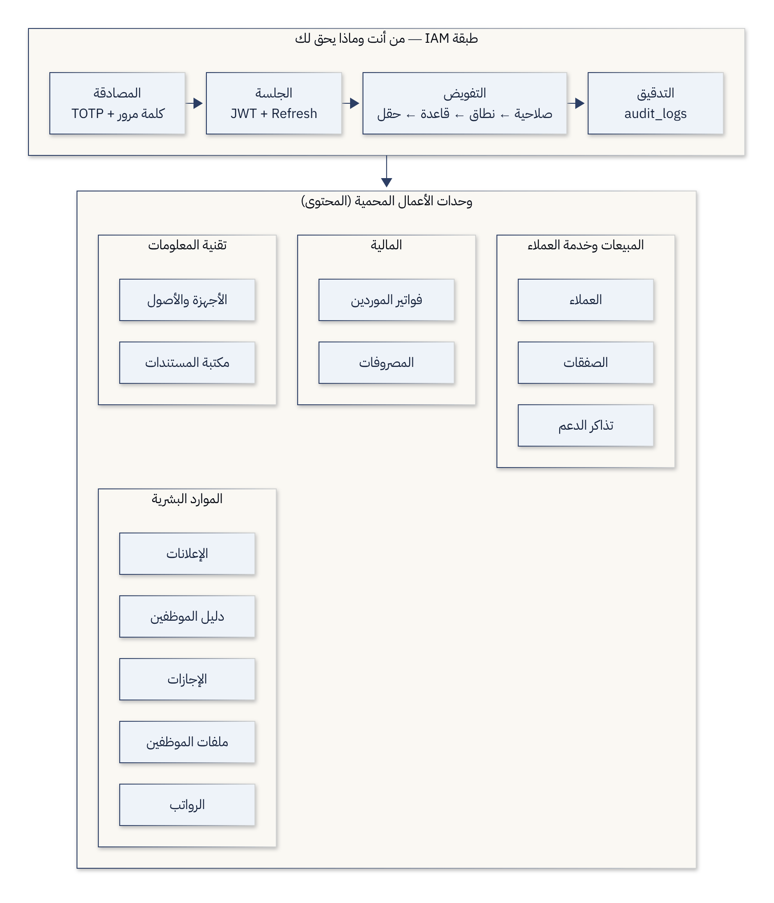

**أدوار وحدات الأعمال:**

| الدور | أهم الصلاحيات |
|---|---|
| `department_manager` | `leave:read:department`, `leave:approve:department` |
| `hr_manager` | كل الإجازات واعتمادها، ملفات الموظفين مع `salary:read`، نشر الإعلانات، قراءة الرواتب |
| `hr_officer` | كل الإجازات (قراءة)، ملفات الموظفين **بدون** الرواتب |
| `finance_officer` | الفواتير (تسجيل + اعتماد حتى 10M)، المصروفات (اعتماد)، إعداد الرواتب |
| `finance_manager` | `invoices:approve_unlimited`, `payroll:approve`, `salary:read` |
| `sales_manager` / `sales_rep` | كل الصفقات + إعادة الإسناد / صفقاته فقط |
| `cs_supervisor` / `cs_agent` | إسناد التذاكر وإغلاقها / معالجة المسندة إليه |
| `executive` | قراءة مؤشرات كل الأقسام بدون أي تعديل |

**الخادم يقرر ما يظهر في الواجهة:** كل سجل يرجع من الـ API مع `_actions` (الأزرار المسموحة) و`_note` (سبب المنع)، محسوبة بنفس الدوال التي تتحقق عند التنفيذ. الواجهة لا تحتوي أي منطق تفويض، وكل صفحة تعرض شريط «الصلاحيات التي تحكم هذه الصفحة» بعلامات ✓/✗.

**الصفحة الرئيسية الشخصية** (`/api/portal/home`) تحسب «بانتظارك» بنفس قواعد الاعتماد: المدير المالي يرى عدد الفواتير **ضمن حده** فقط، ومدير القسم يرى طلبات قسمه فقط.

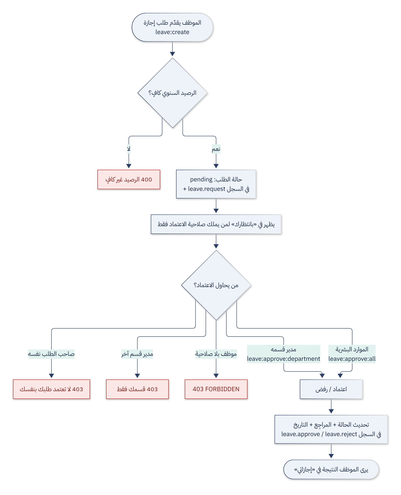

| حيدر (المحاسب) — حدود الاعتماد | مريم (أخصائية HR) — حجب الحقول |
|---|---|
| 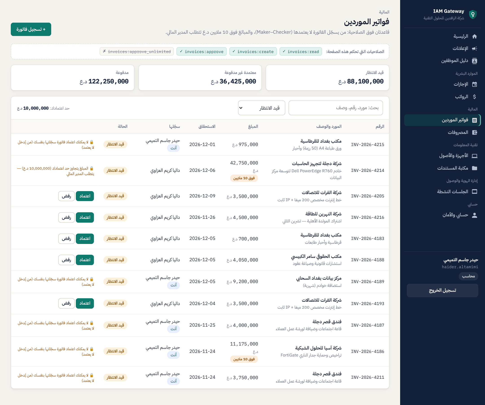 | 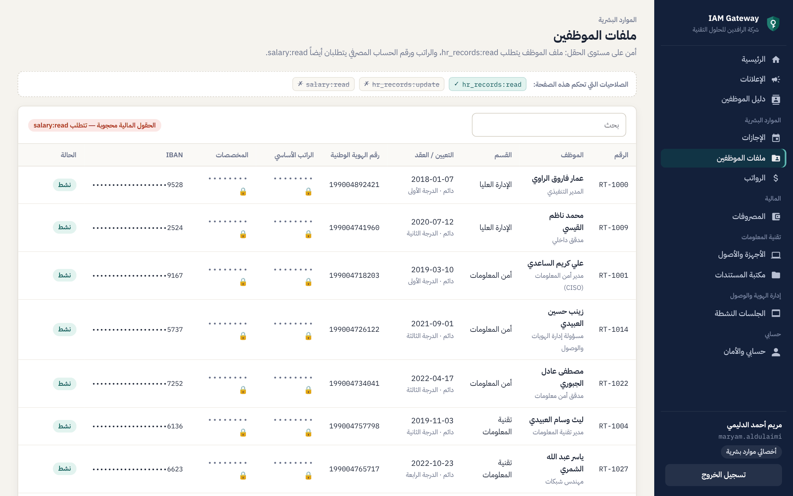 |

## 10. تحليل التهديدات والضوابط الأمنية

### 10.1 تحليل STRIDE

| التهديد | المثال | الضابط في المشروع |
|---|---|---|
| **S**poofing انتحال الهوية | سرقة كلمة مرور | bcrypt + MFA + قفل الحساب + Rate limit |
| **T**ampering العبث | تعديل JWT ليصبح `sub = 1` | توقيع HS256 + التحقق من `iss` و`alg` (اختبار آلي) |
| **R**epudiation الإنكار | «لم أغيّر صلاحيات أحد» | سجل تدقيق بالمنفّذ والوقت وIP |
| **I**nformation Disclosure كشف المعلومات | تسريب ملف القاعدة | لا كلمات مرور صريحة، أسرار MFA مشفّرة، الرموز مخزّنة كبصمات؛ رسائل خطأ لا تكشف التفاصيل |
| **D**enial of Service حجب الخدمة | إغراق نقطة الدخول | Rate limit + حدّ حجم JSON (50KB) |
| **E**levation of Privilege تصعيد الصلاحيات | مسؤول يمنح نفسه دوراً أعلى، موظف يعتمد طلبه، محاسب يعتمد مبلغاً فوق حده | منع تعديل الذات، حماية `super_admin`، فصل المهام، Maker–Checker، حدود الاعتماد، رفض افتراضي |

### 10.2 مقابلة مع OWASP Top 10 (2021)

| الخطر | الضابط |
|---|---|
| A01 Broken Access Control | `requirePermission` على كل مسار + نطاق البيانات في استعلام SQL نفسه + قواعد ملكية السجل (منع IDOR: تغيير رقم السجل في الرابط لا يكفي) + حجب الحقول في الخادم |
| A02 Cryptographic Failures | bcrypt، AES-256-GCM، SHA-256، `crypto.randomBytes`، `timingSafeEqual` |
| A03 Injection | **كل** الاستعلامات Prepared Statements بمعاملات مربوطة؛ كل مخرجات HTML تمر عبر `UI.esc()` ضد XSS |
| A04 Insecure Design | MFA، قفل، تدوير الرموز، فصل المهام صُمّمت من البداية |
| A05 Security Misconfiguration | Helmet، إخفاء `X-Powered-By`، عدم إظهار Stack trace، `Cache-Control: no-store` للـ API |
| A07 Identification & Authentication Failures | سياسة كلمات مرور، منع User Enumeration، انتهاء الجلسات، إلغاء الجلسات عند تغيير كلمة المرور |
| A09 Security Logging & Monitoring Failures | سجل تدقيق شامل + لوحة مراقبة |

### 10.3 ضوابط الويب الإضافية

- **Content-Security-Policy** صارمة: `script-src 'self'` و`script-src-attr 'none'` — لا يُنفَّذ أي سكربت مضمّن أو `onclick`، فحتى لو حُقن HTML لن يعمل كود. (سُمح فقط بخصائص `style=""` عبر `style-src-attr` لأنها لا تنفّذ كوداً.)
- **`frame-ancestors 'none'`** ضد Clickjacking.
- **منع Open Redirect**: معامل `?next=` في صفحة الدخول يُقبل فقط إذا كان مساراً داخلياً.
- **الأسرار** (مفتاح JWT ومفتاح تشفير MFA) لا تُكتب في الكود؛ تُقرأ من متغيرات البيئة أو تُولَّد عشوائياً عند أول تشغيل في `data/secrets.json` (مستثنى من Git).

## 11. البيانات التجريبية

ملف `src/db/seed.js` ينشئ مؤسسة واقعية تعكس سيناريوهات حقيقية:

- **7 أقسام**: الإدارة العليا، أمن المعلومات، تقنية المعلومات، الموارد البشرية، المالية والحسابات، المبيعات، خدمة العملاء.
- **23 موظفاً** بأسماء عراقية وبريد `@alrafidain-tech.iq`: 19 نشط، 2 بانتظار الموافقة، 1 معلّق (تحقيق إداري)، 1 معطّل (موظف سابق)، 1 مقفل، 1 بكلمة مرور مؤقتة، 3 بـ MFA.
- **15 دوراً** و**55 صلاحية**.
- **محتوى أعمال**: 23 ملفاً وظيفياً بالرواتب بالدينار العراقي، ~40 طلب إجازة، 4 مسيّرات رواتب (80 قسيمة)، 37 فاتورة مورد (اشتراك المولدة الأهلية، الإنترنت، تجهيز الحاسبات …)، 32 طلب صرف، 18 عميلاً في 10 محافظات، 32 صفقة، 40 تذكرة دعم، 51 جهازاً، 9 إعلانات.
- **أكثر من 860 حدث تدقيق** على مدى 30 يوماً: دخول يومي في أوقات الدوام (8:00–4:00 بتوقيت بغداد، مع عطلة الجمعة والسبت)، أخطاء كتابة عرضية، وأحداث إدارية (إنشاء، تعليق، إسناد أدوار).
- **3 حوادث أمنية محاكاة**:
  1. **رش كلمات المرور (Password Spraying)** من عقدة Tor `185.220.101.47` على حسابات المسؤولين وأسماء شائعة (`admin`, `root`).
  2. **هجوم تخمين (Brute Force)** من `45.155.205.233` بأداة `python-requests` ضد `abbas.alsudani` ← قفل الحساب.
  3. **إعادة استخدام رمز تحديث مسروق** لحساب المدير المالي من `91.240.118.172` ← إلغاء الجلسة تلقائياً.
- **11 جلسة نشطة** على أجهزة مختلفة (Windows/macOS/iPhone/Android).
- **12 مستنداً محمياً** في 4 تصنيفات (عام، سري، سري للغاية) بمحتوى واقعي.

## 12. الاختبار

### 12.1 الاختبارات الآلية

`npm test` يشغّل **31 اختباراً** (`tests/iam.test.js`) باستخدام مشغّل الاختبارات المدمج في Node.js على **قاعدة بيانات مؤقتة** منفصلة، وكلها ناجحة:

| المجموعة | ما يُختبر |
|---|---|
| TOTP | مطابقة متجهات RFC 6238 الرسمية؛ قبول ±30 ثانية ورفض الرموز القديمة |
| المصادقة | التخزين بـ bcrypt؛ Cookie بخصائص HttpOnly/SameSite؛ رسالة خطأ موحدة؛ القفل بعد 5 محاولات؛ رفض الحسابات pending/suspended/disabled؛ تدفق MFA؛ عدم صلاحية challengeToken كرمز وصول؛ رمز الاسترداد يُستخدم مرة واحدة؛ سياسة التسجيل |
| الجلسات | التدوير وكشف إعادة الاستخدام؛ الخروج يُبطل الـ JWT فوراً؛ رفض JWT معدّل |
| التفويض | الموظف يُرفض في 5 مسارات إدارية مع تسجيلها؛ كل قسم يرى موارده فقط؛ المدقق قراءة فقط؛ منع تصعيد الصلاحيات؛ سحب الدور يسري فوراً |
| دورة الحياة | Joiner بكلمة مرور مؤقتة وإجبار التغيير ومنع إعادة الاستخدام؛ الموافقة؛ Leaver يُنهي الجلسات فوراً |
| الترويسات | CSP، frame-ancestors، nosniff، إخفاء X-Powered-By |
| نطاق البيانات | الإجازات بثلاثة نطاقات؛ طلب نطاق أوسع من صلاحيتك يعود لنطاقك؛ المندوب لا يقرأ ولا يعدّل صفقة زميله |
| قواعد العمل | مدير القسم لا يعتمد طلبه ولا طلبات قسم آخر؛ Maker–Checker وحد 10 ملايين في الفواتير؛ مُعِدّ الرواتب لا يعتمدها؛ موظف الخدمة لا يغلق التذاكر |
| أمن الحقول | الراتب و IBAN محجوبان قراءةً وكتابةً بدون `salary:read`؛ الإعلانات الموجّهة لا تظهر لغير قسمها |

```
# tests 31
# pass 31
# fail 0
```

### 12.2 الاختبار اليدوي للواجهات

اختُبرت جميع الصفحات الـ 22 بمتصفح Chrome آلياً (Playwright) بعشرة مستخدمين بأدوار مختلفة، والتُقطت الصور الـ 44 الموجودة في `docs/screenshots` من هذا التشغيل، دون أي أخطاء JavaScript في وحدة التحكم.

## 13. القيود والتطوير المستقبلي

| القيد الحالي | التطوير المقترح |
|---|---|
| لا يوجد إرسال بريد لاستعادة كلمة المرور | خدمة بريد + رابط استعادة صالح لمرة واحدة |
| MFA عبر TOTP فقط | WebAuthn / Passkeys (مقاومة للتصيّد) |
| قواعد العمل مكتوبة في الكود | محرّك سياسات قابل للتعديل من الواجهة (مثل حدود الاعتماد) وشروط حسب الوقت والموقع والجهاز |
| لا يوجد SSO | OpenID Connect / SAML 2.0 لربط تطبيقات أخرى |
| SQLite لخادم واحد | PostgreSQL + Redis لتوزيع الحمل |
| تنبيهات يدوية من لوحة المراقبة | إرسال تنبيه فوري عند قفل حساب أو اكتشاف سرقة رمز |
| مراجعة الوصول عرض فقط | حملات مراجعة دورية بتوقيع المدير (Access Certification) |

## 14. الخلاصة

حقّق المشروع نظاماً متكاملاً لإدارة الهوية والوصول يحمي بوابة موظفين حقيقية من 12 وحدة أعمال، ويغطي الركائز الأربع: **التعريف** بهويات فريدة، **المصادقة** متعددة العوامل بكلمات مرور مُجزّأة وTOTP مبني من الصفر وفق المعيار، **التفويض** بنموذج RBAC يطبّق أقل الصلاحيات والرفض الافتراضي وفصل المهام، معززاً بنطاق البيانات وقواعد العمل والأمن على مستوى الحقل، و**المساءلة** بسجل تدقيق شامل ولوحة مراقبة تكشف الهجمات. كما عالج المشروع المشكلات العملية الأكثر تسبباً في الاختراقات: الحسابات اليتيمة (دورة الحياة)، الجلسات المسروقة (التدوير والإلغاء الفوري)، والصلاحيات الزائدة (مصفوفة المراجعة). أُثبتت صحة هذه الضوابط بـ 31 اختباراً آلياً ناجحاً.

## 15. المراجع

1. NIST SP 800-63B — *Digital Identity Guidelines: Authentication and Lifecycle Management*.
2. RFC 6238 — *TOTP: Time-Based One-Time Password Algorithm*.
3. RFC 4226 — *HOTP: An HMAC-Based One-Time Password Algorithm*.
4. RFC 7519 — *JSON Web Token (JWT)*.
5. OWASP Top 10 (2021) و OWASP Authentication / Session Management Cheat Sheets.
6. NIST — *Role-Based Access Control* (Ferraiolo, Kuhn, Chandramouli).
7. Provos & Mazières — *A Future-Adaptable Password Scheme* (bcrypt), USENIX 1999.
8. Microsoft — *STRIDE Threat Model*.

</div>
