

# مخططات المشروع

كل مخطط موجود بصيغتين: **صورة PNG** جاهزة للطباعة أو لإدراجها في التقرير الورقي، و**مصدر Mermaid** (ملفات `.mmd` في مجلد `diagrams/`) يعرضه GitHub تلقائياً ويمكن تعديله وإعادة توليده من [mermaid.live](https://mermaid.live).

| # | المخطط | النوع |
|---|---|---|
| 1 | [المخطط المعماري (Architecture)](#01-architecture) | معماري |
| 2 | [مخطط الكيانات والعلاقات (ERD)](#02-erd) | قاعدة بيانات |
| 3 | [دورة حياة الهوية (Identity Lifecycle — Joiner / Mover / Leaver)](#03-identity-lifecycle) | مخطط حالات (State) |
| 4 | [دورة حياة رمز التحديث والجلسة (Token / Session Lifecycle)](#07-token-lifecycle) | مخطط حالات (State) |
| 5 | [مخطط تدفق تسجيل الدخول (Login Flowchart)](#04-login-flowchart) | مخطط تدفق (Flowchart) |
| 6 | [مخطط تدفق التفويض لكل طلب (Authorization Flowchart)](#05-authorization-flowchart) | مخطط تدفق (Flowchart) |
| 7 | [مخطط التتابع: الدخول بخطوتين ثم التجديد ثم الخروج (Sequence Diagram)](#06-auth-sequence) | مخطط تتابع (Sequence) |
| 8 | [نموذج التحكم بالوصول المبني على الأدوار (RBAC Model)](#08-rbac-model) | نموذج مفاهيمي |
| 9 | [دورة حياة تطوير النظام (SDLC — النموذج التكراري التزايدي)](#09-sdlc) | دورة حياة التطوير |

---

## 1. المخطط المعماري (Architecture)

معمارية ثلاثية الطبقات. **طبقة العرض** صفحات HTML/JS في المتصفح تتواصل فقط عبر `api.js` الذي يحفظ رمز الوصول في الذاكرة ويجدده تلقائياً. **طبقة التطبيق** تبدأ بطبقة حماية عامة (Helmet، تحديد المعدل)، ثم مسارات المصادقة العامة `/api/auth`، وكل المسارات الأخرى تمر أولاً بـ **نقطة فرض السياسة (PEP)**: `authenticate` ← `requirePasswordChanged` ← `requirePermission`. المسارات لا تحتوي منطقاً أمنياً معقداً بل تستدعي **طبقة الخدمات**، والخدمات وحدها تتعامل مع **طبقة البيانات** باستعلامات مُعدّة مسبقاً (Prepared Statements).

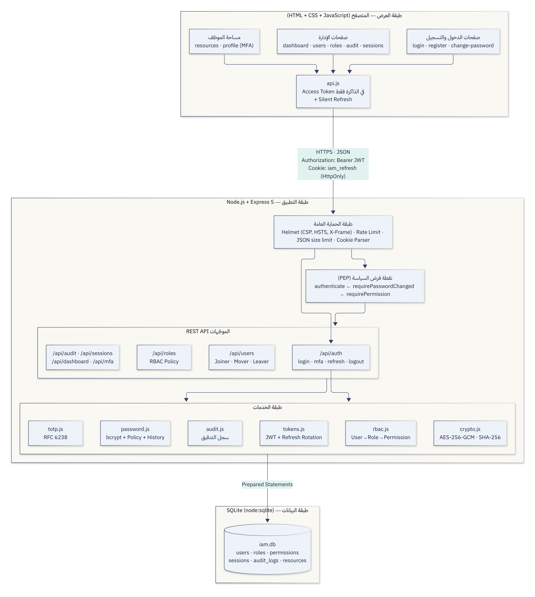

مصدر Mermaid

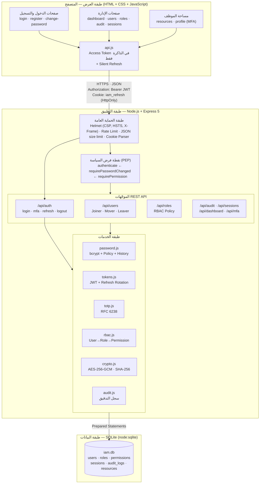

---

## 2. مخطط الكيانات والعلاقات (ERD)

المستخدم ينتمي لقسم واحد. العلاقة **مستخدم ↔ دور** و**دور ↔ صلاحية** كثير-إلى-كثير عبر الجدولين الوسيطين `user_roles` و`role_permissions` (المفتاح الأساسي مركّب من العمودين فلا يتكرر الإسناد). للمستخدم عدة جلسات، وسجل كلمات مرور، ورموز استرداد، وأحداث تدقيق. الحقول الحساسة لا تُخزّن صريحة: `password_hash` (bcrypt)، `mfa_secret_enc` (AES-256-GCM)، `refresh_token_hash` و`code_hash` (SHA-256).

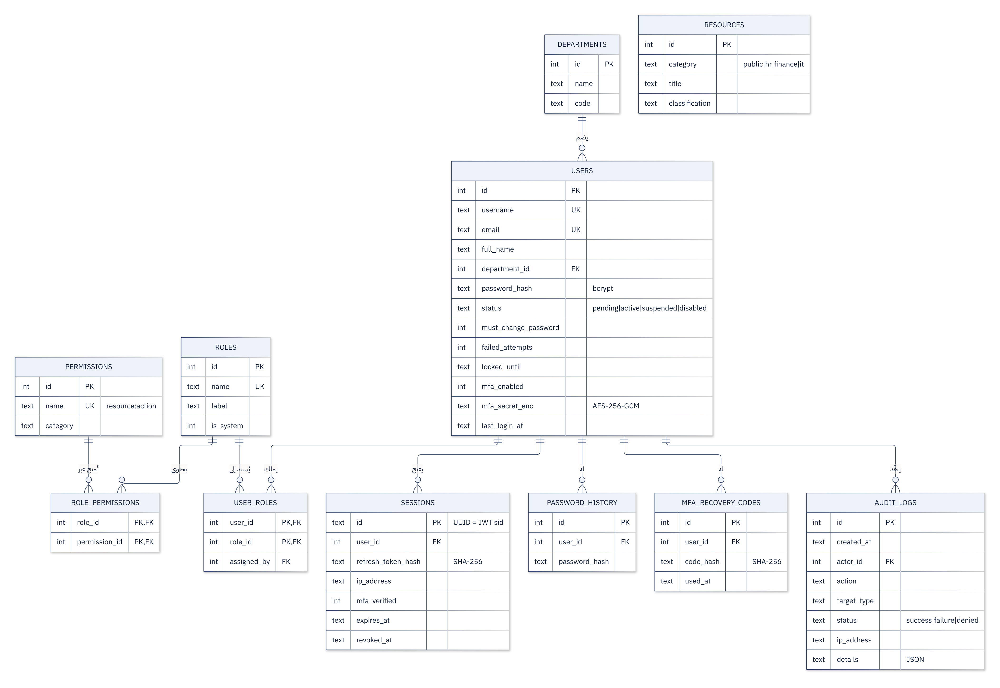

مصدر Mermaid

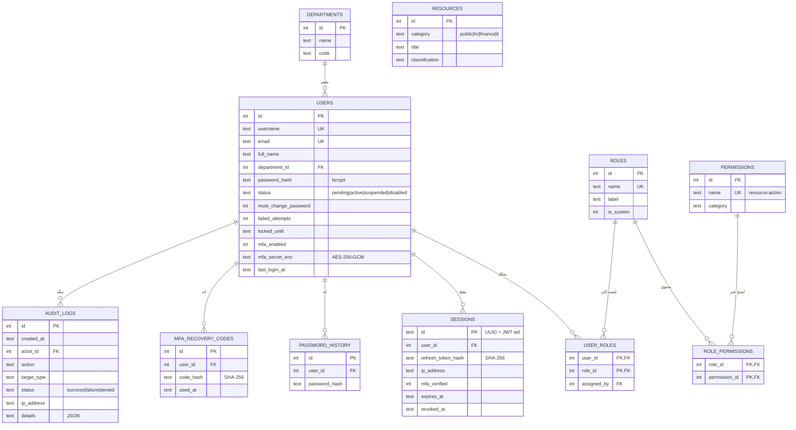

---

## 3. دورة حياة الهوية (Identity Lifecycle — Joiner / Mover / Leaver)

يدخل الحساب النظام بطريقتين: **تسجيل ذاتي** (يبقى `pending` حتى موافقة مسؤول الهويات) أو **إنشاء من المسؤول** (نشط لكن بكلمة مرور مؤقتة يجب تغييرها). الحساب النشط قد يُ**قفل مؤقتاً** آلياً بعد 5 محاولات فاشلة، وقد يتغير دوره (**Mover**) ويسري التغيير فوراً، وقد **يُعلّق** مؤقتاً، وعند مغادرة الموظف يُ**عطّل** نهائياً (**Leaver**). كل انتقال إلى حالة غير نشطة **يُنهي جميع جلسات الحساب فوراً**، وكل انتقال يُسجَّل في سجل التدقيق مع السبب.

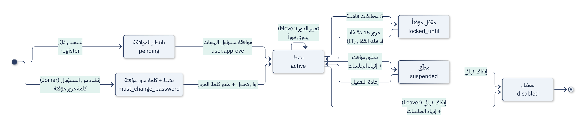

مصدر Mermaid

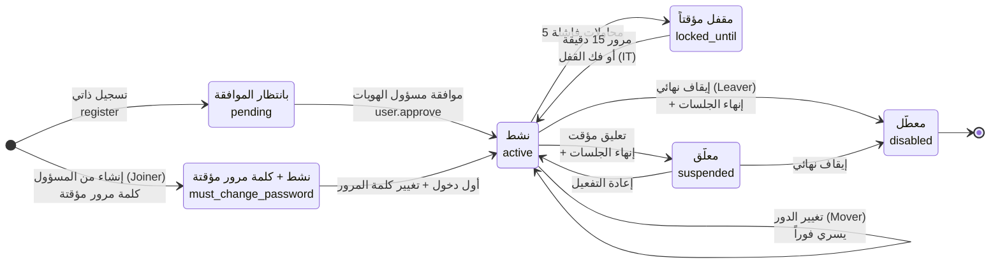

---

## 4. دورة حياة رمز التحديث والجلسة (Token / Session Lifecycle)

رمز التحديث يُصدر عند الدخول، وكل استخدام له يُصدر رمزاً جديداً ويُبطل القديم (**Rotation**). إذا قُدّم رمز قديم مرة أخرى فهذا دليل على أن نسخة منه سُرقت، فتُلغى **الجلسة كاملة** (يخسرها المهاجم والمستخدم معاً، ويضطر المستخدم للدخول من جديد بكلمة المرور وMFA). تنتهي الجلسة أيضاً بتسجيل الخروج، أو إنهائها من المسؤول، أو تغيير كلمة المرور، أو تعطيل الحساب، أو بعد 7 أيام.

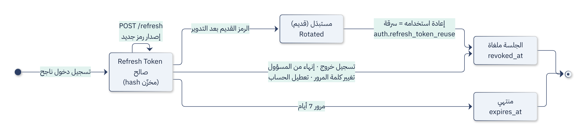

مصدر Mermaid

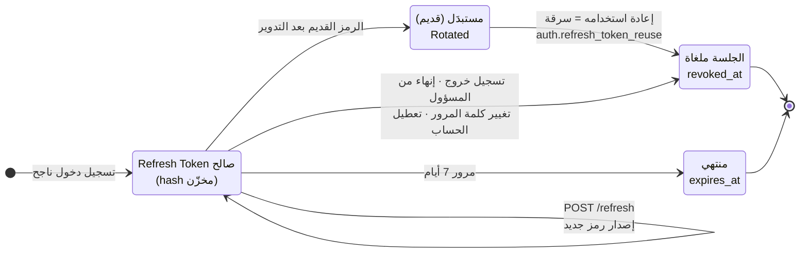

---

## 5. مخطط تدفق تسجيل الدخول (Login Flowchart)

يوضح ترتيب الفحوصات عند الدخول، والترتيب نفسه قرار أمني: (1) **تحديد المعدل** قبل أي عمل مكلف، (2) المستخدم غير الموجود يمر بمقارنة bcrypt وهمية ليتساوى زمن الاستجابة، (3) **فحص القفل قبل فحص كلمة المرور** حتى لا يستمر التخمين على حساب مقفل، (4) فحص الحالة بعد كلمة المرور الصحيحة فقط (كي لا نكشف حالة الحساب لمن لا يعرف كلمة مروره)، (5) لا تُنشأ جلسة قبل اجتياز MFA.

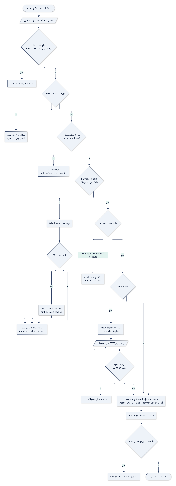

مصدر Mermaid

---

## 6. مخطط تدفق التفويض لكل طلب (Authorization Flowchart)

ما يحدث في **كل** طلب API محمي. سبع نقاط رفض محتملة قبل الوصول إلى البيانات. لاحظ أن الصلاحيات تُحمّل من قاعدة البيانات **في كل طلب** ولا تُقرأ من الرمز، فسحب الصلاحية أو تعطيل الحساب أو إنهاء الجلسة يسري فوراً. كل رفض تفويض (403) يُسجّل في سجل التدقيق مع الصلاحية الناقصة.

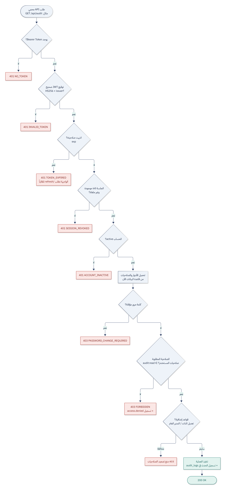

مصدر Mermaid

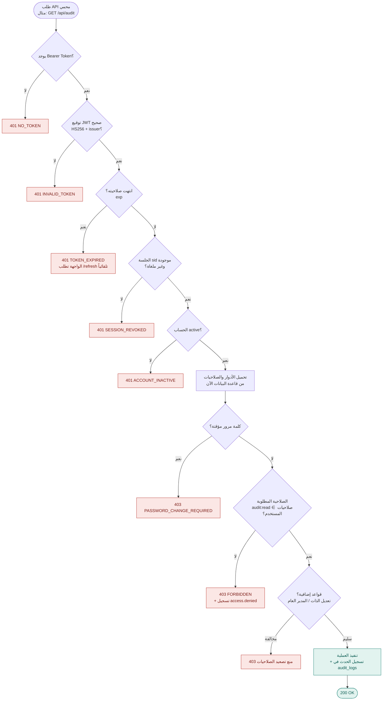

---

## 7. مخطط التتابع: الدخول بخطوتين ثم التجديد ثم الخروج (Sequence Diagram)

التسلسل الزمني للرسائل بين المستخدم والمتصفح والخادم وقاعدة البيانات: الخطوة الأولى (كلمة المرور) تعيد `challengeToken` فقط، والخطوة الثانية (TOTP) تنشئ الجلسة. عند انتهاء رمز الوصول بعد 15 دقيقة يحصل `api.js` تلقائياً على رمز جديد عبر الـ Cookie ويعيد الطلب دون أن يشعر المستخدم (**Silent Refresh**).

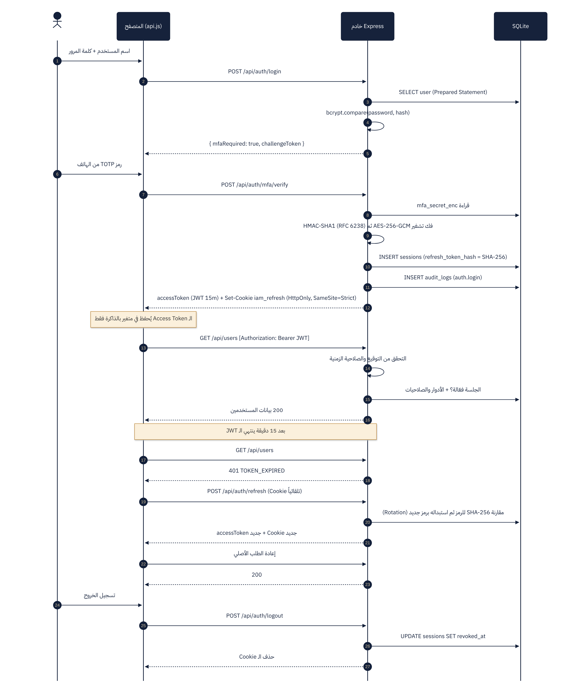

مصدر Mermaid

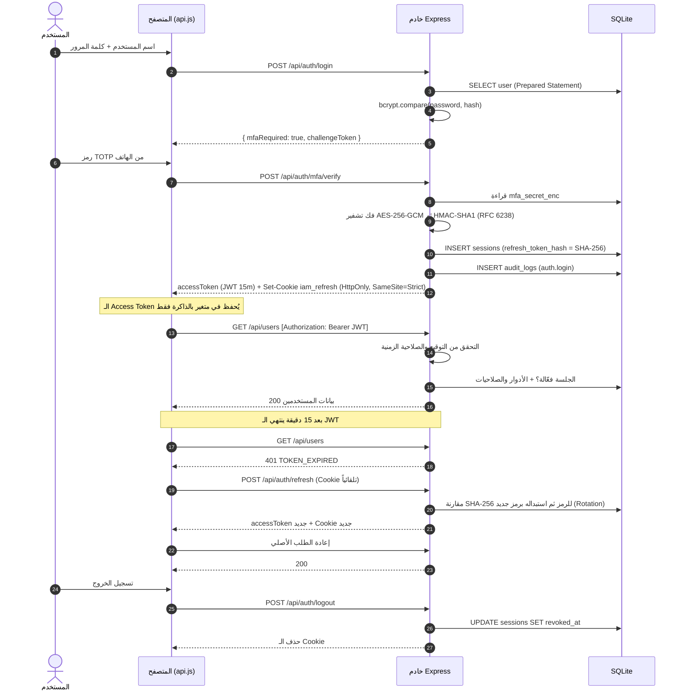

---

## 8. نموذج التحكم بالوصول المبني على الأدوار (RBAC Model)

مثال من البيانات الحقيقية: كل موظف يملك دور `employee` إضافة إلى دوره الوظيفي. الصلاحيات تُمنح للأدوار لا للأشخاص؛ فعند انضمام محاسب جديد يكفي إسناد دور `finance_officer` له. لاحظ **فصل المهام**: `iam_admin` يُسند الأدوار لكنه لا يملك `roles:manage` لتعديل ما تحتويه الأدوار.

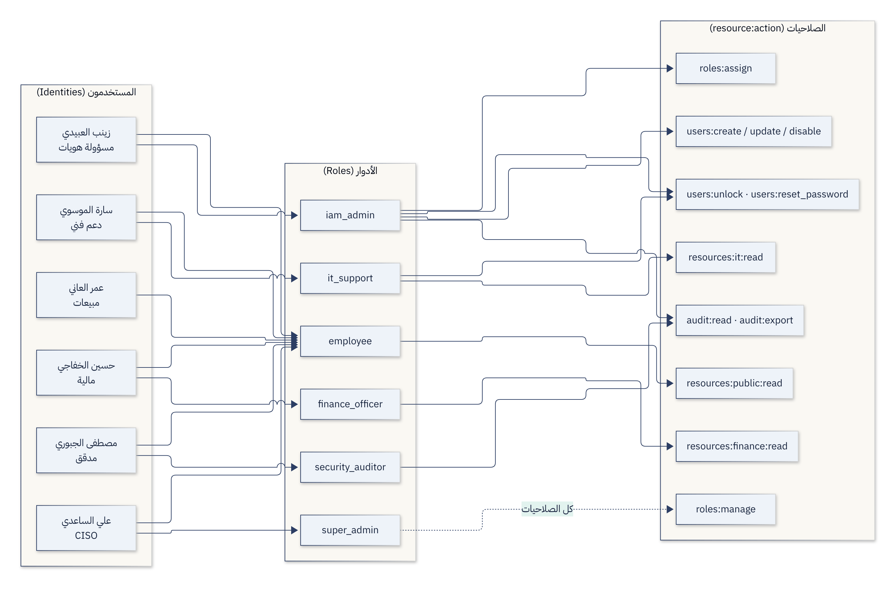

مصدر Mermaid

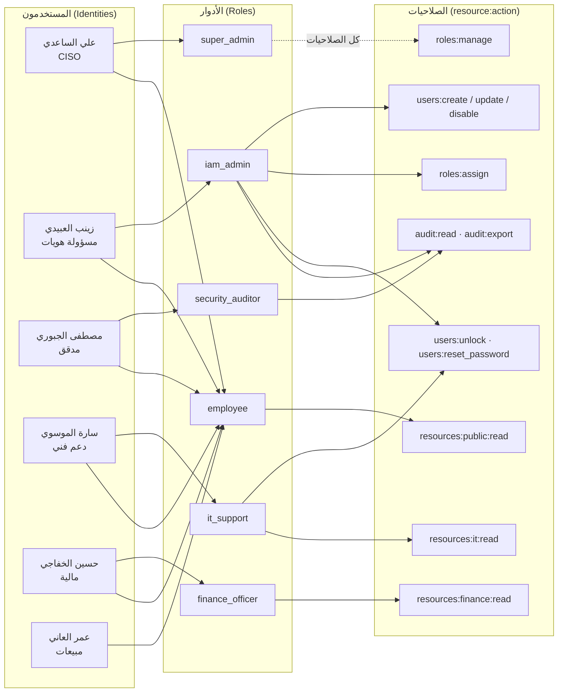

---

## 9. دورة حياة تطوير النظام (SDLC — النموذج التكراري التزايدي)

المراحل السبع التي مرّ بها المشروع، مع تغذية راجعة من مرحلة الصيانة والمراقبة إلى مرحلة التحليل؛ فما يكشفه سجل التدقيق من هجمات يتحول إلى متطلبات أمنية جديدة في التكرار التالي.

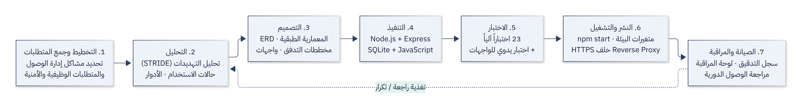

مصدر Mermaid

