

# مخططات المشروع

كل مخطط بصيغتين: **صورة PNG** للطباعة، و**مصدر Mermaid** (ملفات `.mmd` في `diagrams/`) يعرضه GitHub ويمكن تعديله من [mermaid.live](https://mermaid.live).

| # | المخطط | النوع |
|---|---|---|
| 1 | [المخطط المعماري (Architecture)](#01-architecture) | معماري |
| 2 | [طبقة IAM فوق وحدات الأعمال](#10-business-modules) | معماري |
| 3 | [مخطط الكيانات والعلاقات (ERD)](#02-erd) | قاعدة بيانات |
| 4 | [نموذج RBAC مع النطاقات](#08-rbac-model) | نموذج مفاهيمي |
| 5 | [مخطط تدفق التفويض لكل طلب](#05-authorization-flowchart) | مخطط تدفق (Flowchart) |
| 6 | [مخطط تدفق اعتماد الإجازة (مثال عملي)](#11-leave-approval-flow) | مخطط تدفق (Flowchart) |
| 7 | [دورة حياة الهوية (Joiner / Mover / Leaver)](#03-identity-lifecycle) | مخطط حالات (State) |
| 8 | [دورة حياة رمز التحديث والجلسة](#07-token-lifecycle) | مخطط حالات (State) |
| 9 | [مخطط تدفق تسجيل الدخول](#04-login-flowchart) | مخطط تدفق (Flowchart) |
| 10 | [مخطط التتابع: الدخول بخطوتين ثم التجديد ثم الخروج](#06-auth-sequence) | مخطط تتابع (Sequence) |
| 11 | [دورة حياة تطوير النظام (SDLC)](#09-sdlc) | دورة حياة التطوير |
| 12 | [مسار الطلب عبر الـ Middleware](#12-middleware-pipeline) | مخطط تدفق (Flowchart) |

---

## 1. المخطط المعماري (Architecture)

معمارية ثلاثية الطبقات. **طبقة العرض** صفحات HTML/JS في المتصفح تتواصل فقط عبر `api.js` الذي يحفظ رمز الوصول في الذاكرة ويجدده تلقائياً. **طبقة التطبيق** تبدأ بطبقة حماية عامة (Helmet، تحديد المعدل)، ثم مسارات المصادقة العامة `/api/auth`، وكل المسارات الأخرى (الإدارة ووحدات الأعمال `/api/hr`, `/api/finance`, `/api/ops`, `/api/portal`) تمر أولاً بـ **نقطة فرض السياسة (PEP)**: `authenticate` ← `requirePasswordChanged` ← `requirePermission / requireAny`. المسارات تستدعي **طبقة الخدمات**، والخدمات وحدها تتعامل مع **طبقة البيانات** باستعلامات مُعدّة مسبقاً (Prepared Statements).

مصدر Mermaid

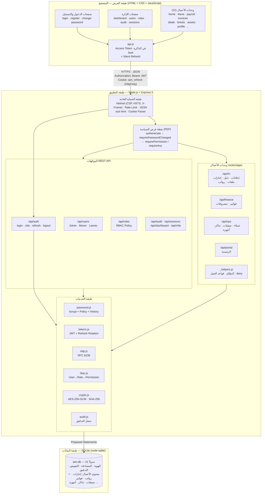

---

## 2. طبقة IAM فوق وحدات الأعمال

الفكرة الأساسية للمشروع: IAM ليس غاية بذاته، بل طبقة تحمي **محتوى حقيقياً**. 12 وحدة أعمال في أربعة مجالات، وكل طلب إلى أي منها يمر بالمصادقة والجلسة ثم التفويض بطبقاته الأربع (صلاحية ← نطاق ← قاعدة عمل ← حقل) ثم يُسجَّل في التدقيق.

مصدر Mermaid

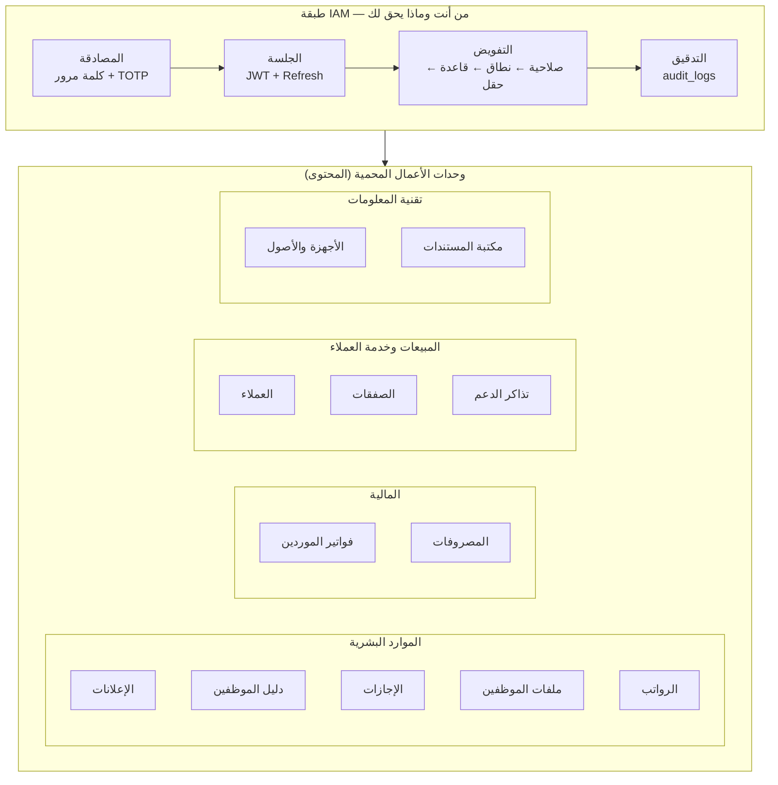

---

## 3. مخطط الكيانات والعلاقات (ERD)

21 جدولاً. في الأعلى جداول الهوية والتفويض (users, roles, permissions والجداول الوسيطة)، وفي الأسفل جداول المحتوى المحمي. لاحظ أن كل جدول أعمال يرتبط بالمستخدم بعمود **ملكية** (`user_id`, `owner_id`, `assigned_to`, `created_by`) — هذا العمود هو ما تعتمد عليه قواعد النطاق «بياناتي/قسمي» وقواعد فصل المهام «لا تعتمد ما أنشأته». الحقول الحساسة لا تُخزّن صريحة (bcrypt، AES-256-GCM، SHA-256)، والراتب و IBAN محجوبان على مستوى الحقل.

مصدر Mermaid

```mermaid
erDiagram
  DEPARTMENTS ||--o{ USERS : "يضم"
  USERS ||--o{ USER_ROLES : "يملك"
  ROLES ||--o{ USER_ROLES : "يُسند إلى"
  ROLES ||--o{ ROLE_PERMISSIONS : "يحتوي"
  PERMISSIONS ||--o{ ROLE_PERMISSIONS : "تُمنح عبر"
  USERS ||--o{ SESSIONS : "يفتح"
  USERS ||--o{ PASSWORD_HISTORY : "له"
  USERS ||--o{ MFA_RECOVERY_CODES : "له"
  USERS ||--o{ AUDIT_LOGS : "ينفّذ"
  USERS ||--|| EMPLOYEE_PROFILES : "ملف وظيفي"
  USERS ||--o{ LEAVE_REQUESTS : "يطلب / يعتمد"
  USERS ||--o{ EXPENSE_CLAIMS : "يقدّم"
  PAYROLL_RUNS ||--o{ PAYSLIPS : "يحتوي"
  USERS ||--o{ PAYSLIPS : "يستلم"
  USERS ||--o{ INVOICES : "يسجّل / يعتمد"
  CUSTOMERS ||--o{ DEALS : "له"
  USERS ||--o{ DEALS : "يملك"
  CUSTOMERS ||--o{ TICKETS : "يفتح"
  USERS ||--o{ TICKETS : "مسندة إلى"
  USERS ||--o{ ASSETS : "يستلم"
  DEPARTMENTS ||--o{ ANNOUNCEMENTS : "موجّه إلى"

  DEPARTMENTS { int id PK
    text name
    text code }
  USERS { int id PK
    text username UK
    text email UK
    text full_name
    int department_id FK
    text password_hash "bcrypt"
    text status "pending|active|suspended|disabled"
    int must_change_password
    int failed_attempts
    text locked_until
    int mfa_enabled
    text mfa_secret_enc "AES-256-GCM"
    text last_login_at }
  ROLES { int id PK
    text name UK
    text label
    int is_system }
  PERMISSIONS { int id PK
    text name UK "resource:action"
    text category }
  USER_ROLES { int user_id PK,FK
    int role_id PK,FK
    int assigned_by FK }
  ROLE_PERMISSIONS { int role_id PK,FK
    int permission_id PK,FK }
  SESSIONS { text id PK "UUID = JWT sid"
    int user_id FK
    text refresh_token_hash "SHA-256"
    text ip_address
    int mfa_verified
    text expires_at
    text revoked_at }
  PASSWORD_HISTORY { int id PK
    int user_id FK
    text password_hash }
  MFA_RECOVERY_CODES { int id PK
    int user_id FK
    text code_hash "SHA-256"
    text used_at }
  AUDIT_LOGS { int id PK
    text created_at
    int actor_id FK
    text action
    text target_type
    text status "success|failure|denied"
    text ip_address
    text details "JSON" }
  RESOURCES { int id PK
    text category "public|hr|finance|it"
    text title
    text classification }
  EMPLOYEE_PROFILES { int user_id PK,FK
    text employee_no
    text national_id
    int base_salary "حقل حساس"
    text bank_iban "حقل حساس" }
  LEAVE_REQUESTS { int id PK
    int user_id FK
    text type
    int days
    text status
    int reviewed_by FK }
  PAYROLL_RUNS { int id PK
    text period
    text status
    int prepared_by FK
    int approved_by FK }
  PAYSLIPS { int id PK
    int run_id FK
    int user_id FK
    int net }
  INVOICES { int id PK
    text number
    int amount
    int created_by FK
    int approved_by FK }
  EXPENSE_CLAIMS { int id PK
    int user_id FK
    int amount
    text status }
  CUSTOMERS { int id PK
    text name
    int account_manager_id FK }
  DEALS { int id PK
    int customer_id FK
    int owner_id FK
    int value
    text stage }
  TICKETS { int id PK
    int customer_id FK
    int assigned_to FK
    text status }
  ASSETS { int id PK
    text tag
    int assigned_to FK
    text status }
  ANNOUNCEMENTS { int id PK
    int department_id FK "NULL = الجميع" }
```

---

## 4. نموذج RBAC مع النطاقات

أمثلة حقيقية من البيانات: كل موظف يملك دور `employee` (خدمة ذاتية: إجازاتي، قسائمي، مصروفاتي) إضافة إلى دوره الوظيفي. الصلاحيات بصيغة `مورد:إجراء:نطاق`. لاحظ **التدرّج**: `deals:read:own` للمندوب و`deals:read:all` للمدير، و`invoices:approve` (حتى 10 ملايين) للمحاسب و`invoices:approve_unlimited` للمدير المالي، و`hr_records:read` لأخصائية الموارد البشرية بدون `salary:read`.

مصدر Mermaid

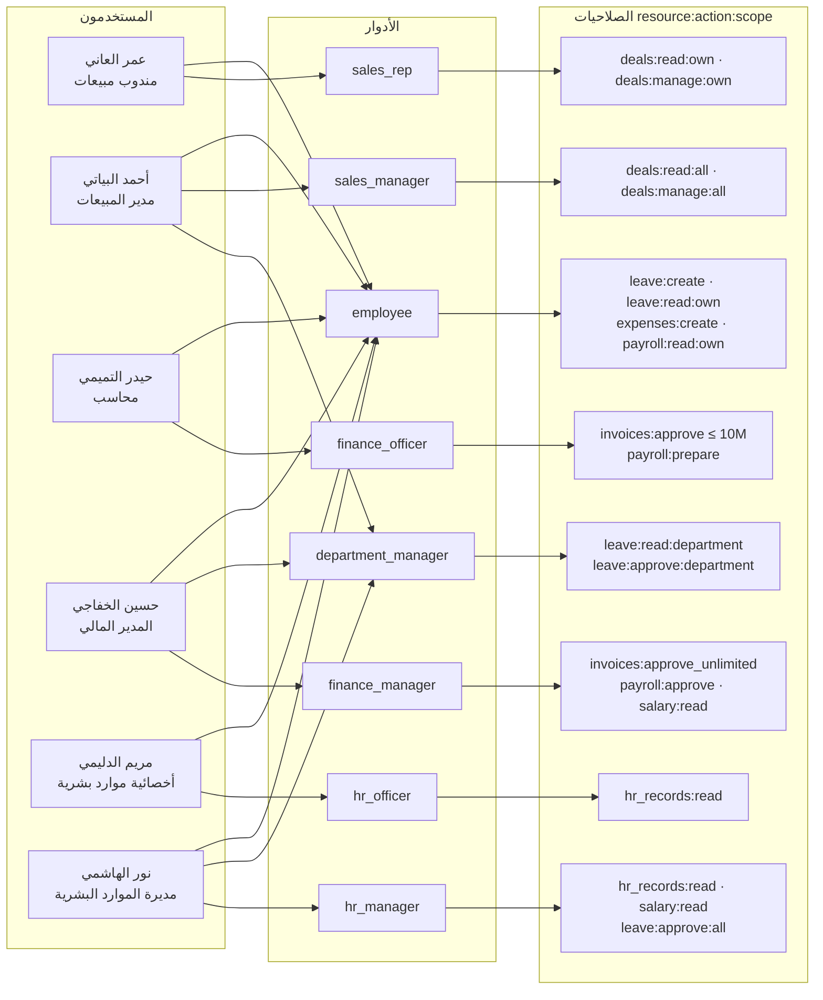

---

## 5. مخطط تدفق التفويض لكل طلب

ما يحدث في **كل** طلب API محمي. بعد المصادقة يمر الطلب بأربع طبقات تفويض (باللون الذهبي): ① **الصلاحية** هل يملك `invoices:approve`؟ ② **النطاق** أي صفوف يراها؟ ③ **قاعدة العمل** على هذا السجل بعينه: ليس طلبه، ضمن حده المالي، من قسمه، مسند إليه. ④ **تصفية الحقول** الحساسة. كل رفض يُسجّل مع سببه.

مصدر Mermaid

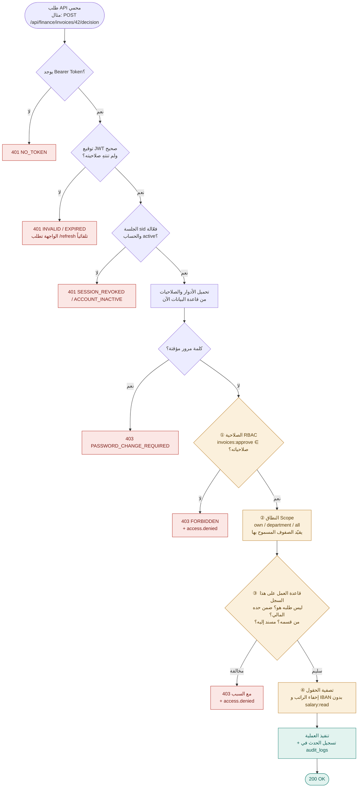

---

## 6. مخطط تدفق اعتماد الإجازة (مثال عملي)

مثال كامل لعملية أعمال محمية: من تقديم الطلب حتى ظهور النتيجة. يوضح كيف تمنع القواعد الاعتماد الذاتي والاعتماد من خارج القسم، وكيف يظهر الطلب في «بانتظارك» فقط لمن يملك صلاحية التصرف فيه.

مصدر Mermaid

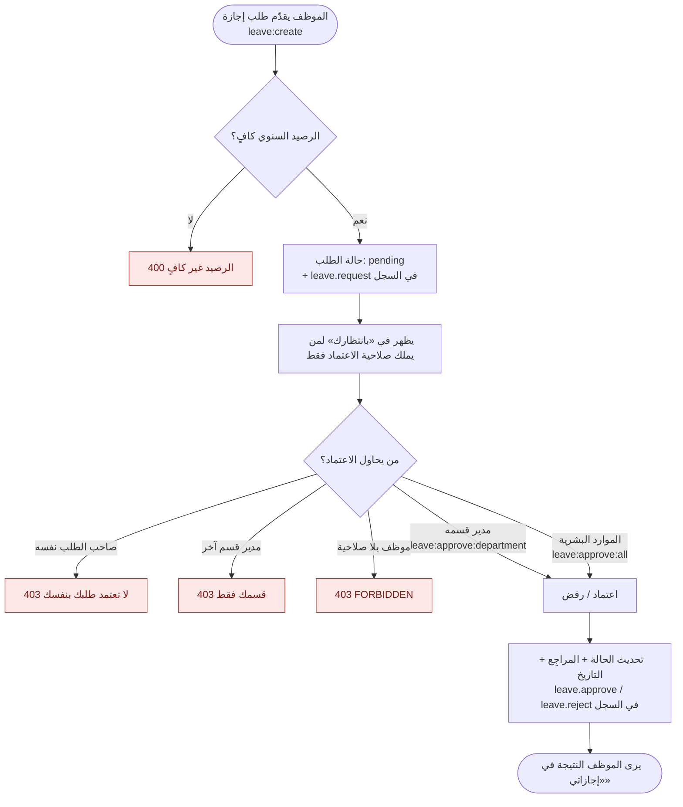

---

## 7. دورة حياة الهوية (Joiner / Mover / Leaver)

يدخل الحساب النظام بطريقتين: **تسجيل ذاتي** (يبقى `pending` حتى موافقة مسؤول الهويات) أو **إنشاء من المسؤول** (نشط بكلمة مرور مؤقتة يجب تغييرها). الحساب النشط قد يُ**قفل مؤقتاً** بعد 5 محاولات فاشلة، وقد يتغير دوره (**Mover**) فيسري فوراً، وقد **يُعلّق**، وعند المغادرة يُ**عطّل** (**Leaver**) وتُنهى كل جلساته فوراً. صفحة الأصول تكشف بعدها الأجهزة التي ما زالت لدى الموظف المغادر.

مصدر Mermaid

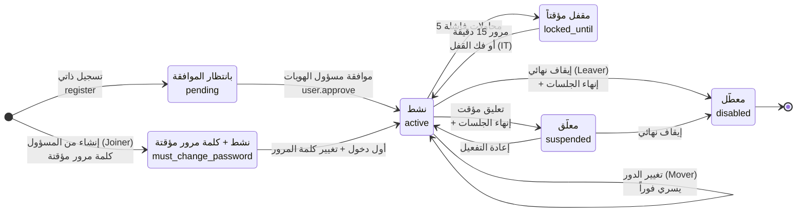

---

## 8. دورة حياة رمز التحديث والجلسة

رمز التحديث يُصدر عند الدخول، وكل استخدام له يُصدر رمزاً جديداً ويُبطل القديم (**Rotation**). إذا قُدّم رمز قديم مرة أخرى فهذا دليل سرقة فتُلغى **الجلسة كاملة**. تنتهي الجلسة أيضاً بتسجيل الخروج، أو إنهائها من المسؤول، أو تغيير كلمة المرور، أو تعطيل الحساب، أو بعد 7 أيام.

مصدر Mermaid

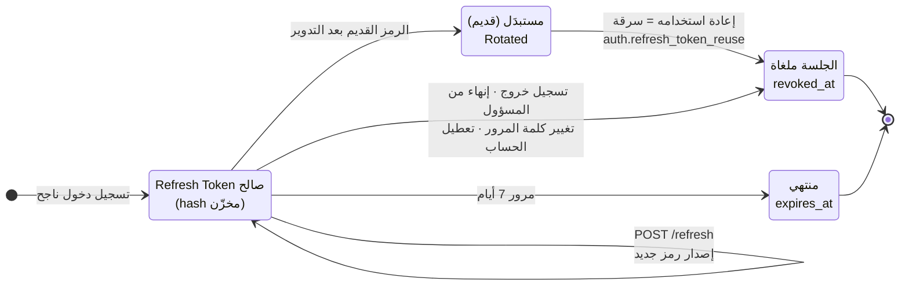

---

## 9. مخطط تدفق تسجيل الدخول

ترتيب الفحوصات قرار أمني: (1) **تحديد المعدل** أولاً، (2) المستخدم غير الموجود يمر بمقارنة bcrypt وهمية ليتساوى الزمن، (3) **فحص القفل قبل كلمة المرور**، (4) فحص الحالة بعد كلمة المرور الصحيحة فقط، (5) لا جلسة قبل اجتياز MFA.

مصدر Mermaid

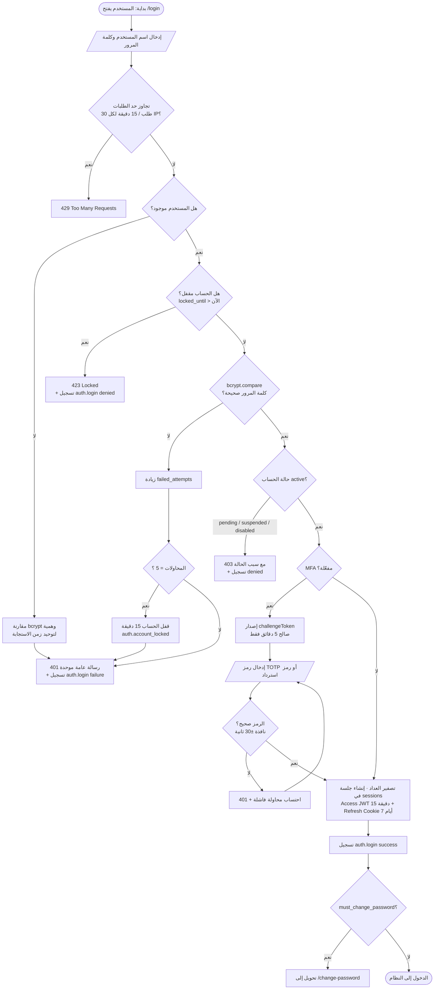

---

## 10. مخطط التتابع: الدخول بخطوتين ثم التجديد ثم الخروج

التسلسل الزمني للرسائل بين المستخدم والمتصفح والخادم وقاعدة البيانات، بما فيه التجديد الصامت (Silent Refresh) عند انتهاء رمز الوصول.

مصدر Mermaid

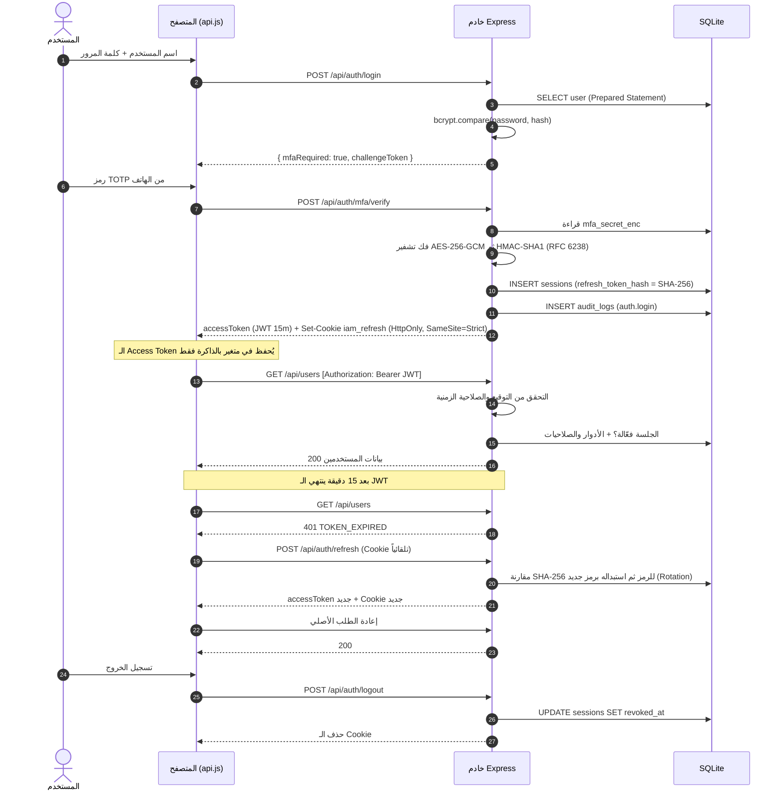

---

## 11. دورة حياة تطوير النظام (SDLC)

المراحل السبع بالنموذج التكراري التزايدي، مع تغذية راجعة من المراقبة إلى التحليل. التكرار الخامس أضاف وحدات الأعمال فوق طبقة IAM.

مصدر Mermaid

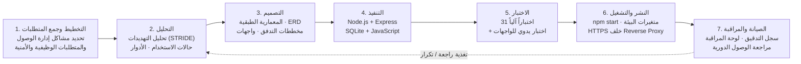

---

## 12. مسار الطلب عبر الـ Middleware

كيف يمر كل طلب API عبر 13 مرحلة بالترتيب: طبقة الحماية العامة في `app.js` (helmet، حد حجم JSON، Cookie، منع التخزين المؤقت، تحديد المعدل)، ثم نقطة فرض السياسة في `middleware/auth.js` (المصادقة، كلمة المرور المؤقتة، الصلاحية)، ثم معالج المسار (النطاق، قاعدة العمل، تصفية الحقول، التدقيق)، ثم معالج الأخطاء المركزي. كل فشل يتوقف عنده الطلب برمز محدد.

مصدر Mermaid

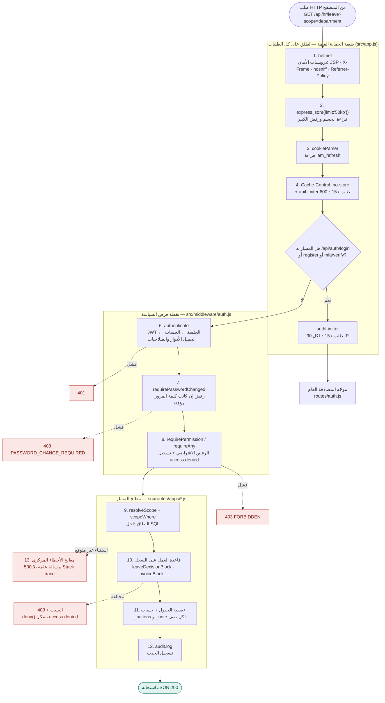

