

# جولة مصوّرة في واجهات النظام
## كيف تحقّق Identity and Access Management (IAM) and Authentication عملياً

كل الصور التالية مأخوذة من النظام وهو يعمل على البيانات التجريبية، ومرتبة حسب ركائز IAM. تحت كل صورة شرح لما تثبته الصورة والكود المسؤول عنها.

**المحتويات:**
[أ. المصادقة](#أ-المصادقة-authentication) ·
[ب. دورة حياة الهوية](#ب-دورة-حياة-الهوية-identity-lifecycle) ·
[ج. التفويض RBAC](#ج-التفويض-authorization--rbac) ·
[د. الجلسات](#د-إدارة-الجلسات-session-management) ·
[هـ. المساءلة والمراقبة](#هـ-المساءلة-والمراقبة-accountability--monitoring)

---

## أ. المصادقة (Authentication)

### 1. صفحة تسجيل الدخول — الخطوة الأولى «شيء تعرفه»

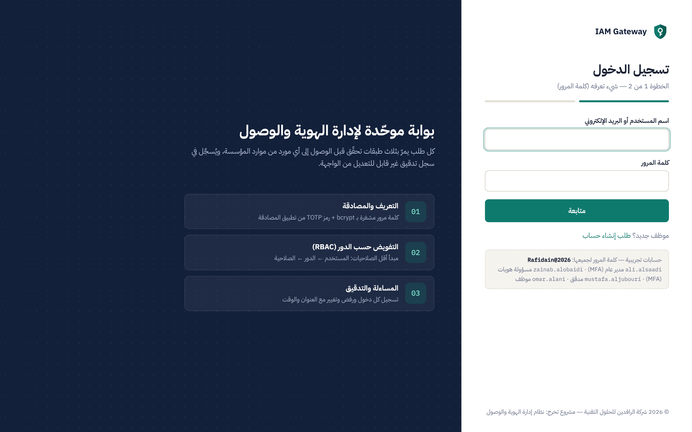

- مؤشر الخطوات يوضح أن الدخول على مرحلتين.
- الجانب الأيسر يلخّص طبقات الحماية الثلاث التي يمر بها كل طلب.
- الصفحة لا تحتوي أي JavaScript مضمّن؛ كل السكربتات من ملفات خارجية بسبب سياسة CSP الصارمة.
- **الكود:** `public/login.html`, `public/js/login.js`, `src/routes/auth.js → POST /login`

### 2. المحاولات الفاشلة — رسالة موحدة وتحذير قبل القفل

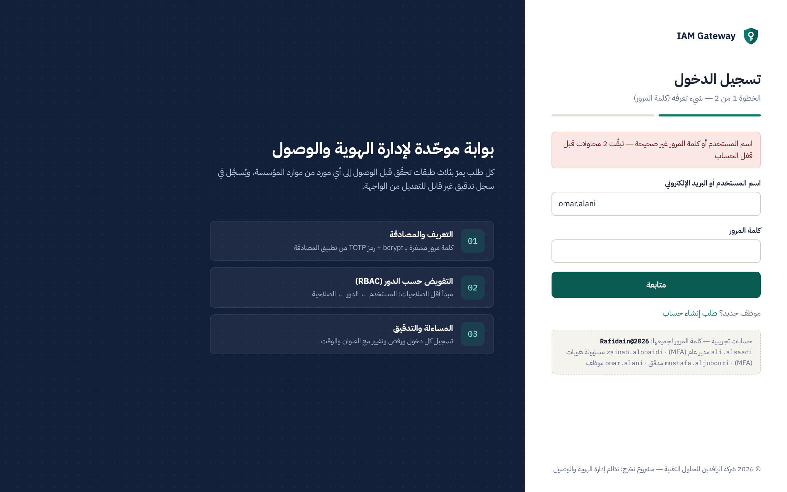

- الرسالة «اسم المستخدم أو كلمة المرور غير صحيحة» **واحدة** سواء كان الاسم موجوداً أم لا، فلا يستطيع المهاجم معرفة الحسابات الموجودة (منع User Enumeration).
- بعد المحاولة الثالثة يُنبَّه المستخدم الحقيقي بعدد المحاولات المتبقية قبل القفل.
- كل محاولة فاشلة تُسجَّل في سجل التدقيق بالحدث `auth.login` ونتيجة `failure`.

### 3. الحساب المقفل — الحماية من التخمين (Brute Force)

- الحساب `abbas.alsudani` تعرّض لهجوم تخمين من العنوان الخارجي `45.155.205.233` فقُفل بعد 5 محاولات.
- حتى **مع كلمة المرور الصحيحة** يُرفض الدخول (HTTP 423)، لأن فحص القفل يتم **قبل** فحص كلمة المرور.
- يُفتح تلقائياً بعد 15 دقيقة، أو فوراً من الدعم الفني (الصورة 10).

### 4. الخطوة الثانية — المصادقة الثنائية TOTP «شيء تملكه»

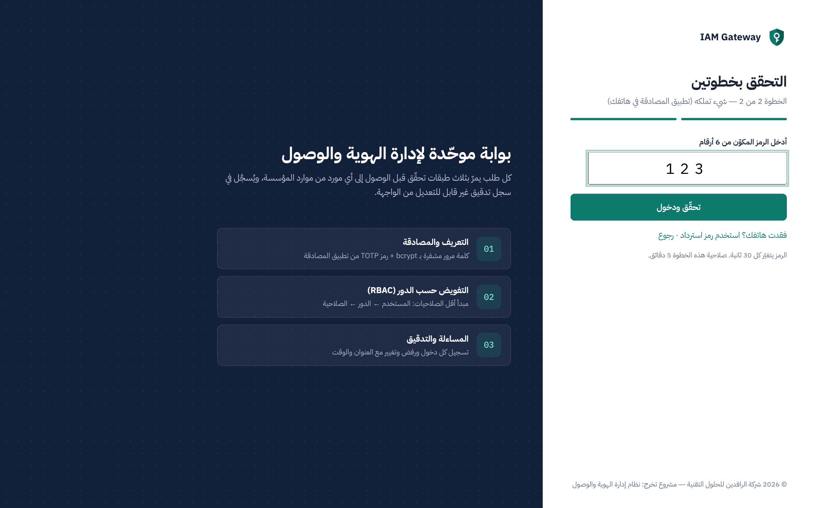

- بعد كلمة المرور الصحيحة لحساب مفعّل عليه MFA **لا تُنشأ جلسة**، بل يحصل المتصفح على `challengeToken` صالح 5 دقائق ولا يصلح لأي عملية أخرى.
- يُدخل المستخدم الرمز المكوّن من 6 أرقام من تطبيق Google/Microsoft Authenticator، ويُرسل تلقائياً عند اكتمال الأرقام.
- رابط «فقدت هاتفك؟» يسمح باستخدام **رمز استرداد** صالح لمرة واحدة.
- الرموز الخاطئة تُحتسب ضمن محاولات القفل، فلا يمكن تجربة المليون احتمال.
- **الكود:** `src/services/totp.js` (تنفيذ RFC 6238 من الصفر)، `src/routes/auth.js → POST /mfa/verify`

### 5. التسجيل الذاتي — سياسة كلمات المرور

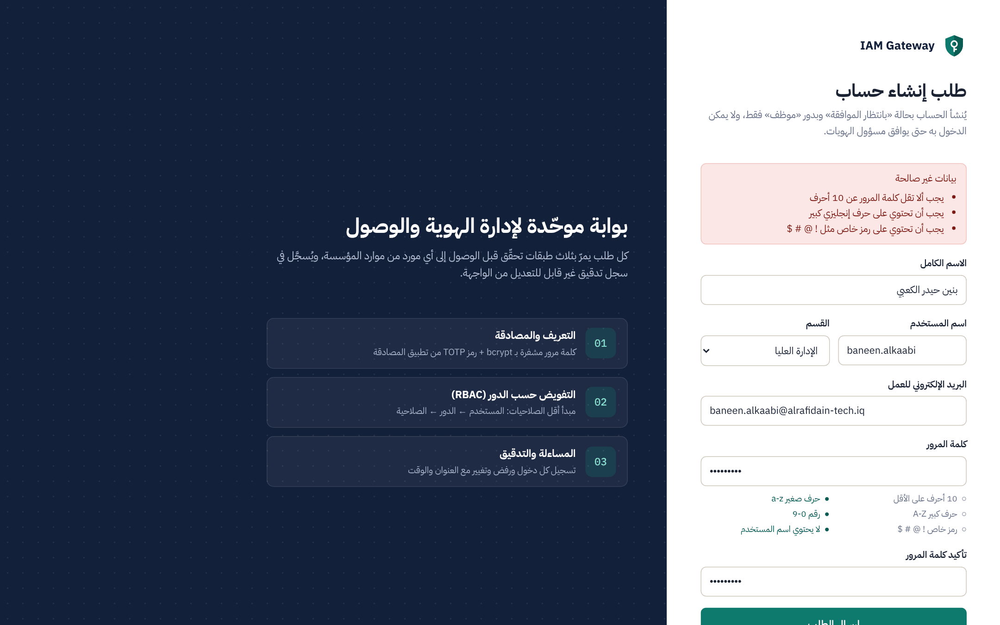

- قائمة تحقق حيّة تحت حقل كلمة المرور توضح الشروط.
- عند إرسال كلمة مرور ضعيفة (`baneen123`) **يرفضها الخادم** ويعيد قائمة بكل المخالفات — التحقق الحقيقي في الخادم وليس في المتصفح فقط.
- الحساب الناجح يُنشأ بحالة «بانتظار الموافقة» ودور «موظف» فقط (أقل الصلاحيات).
- **الكود:** `src/services/password.js → validatePolicy()`

### 6. حساب معلّق — حالة الحساب جزء من المصادقة

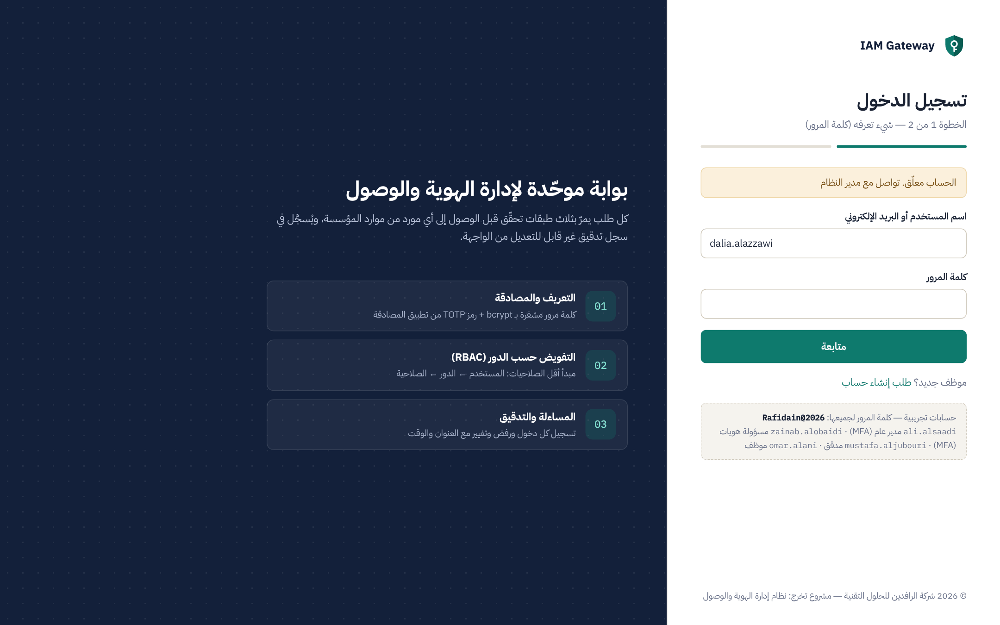

- الموظفة `dalia.alazzawi` معلّقة بسبب تحقيق إداري. كلمة مرورها صحيحة لكن الدخول مرفوض (HTTP 403) ويُسجَّل الحدث `auth.login` بنتيجة `denied` والسبب `status_suspended`.

### 20. إعداد المصادقة الثنائية من صفحة «حسابي والأمان»

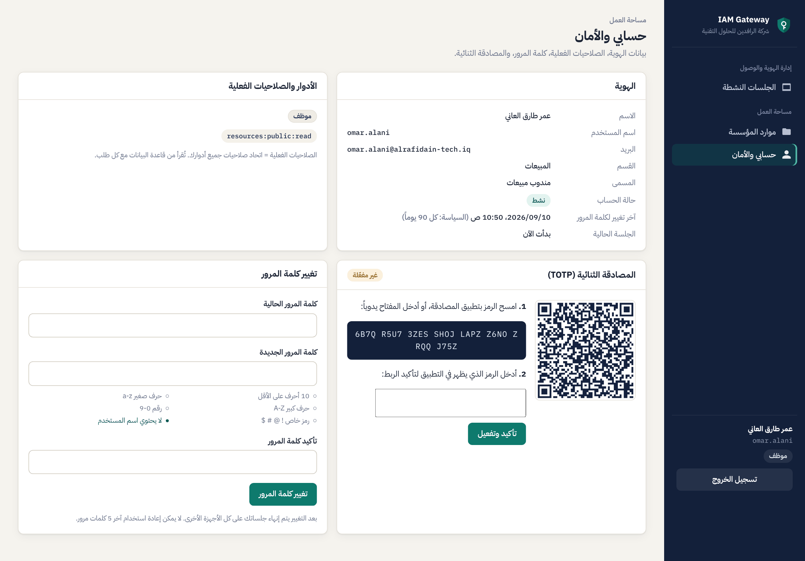

- يولّد الخادم سرّاً عشوائياً 160 بت ويعرضه كرمز QR وكنص لإدخاله يدوياً.
- MFA **لا تُفعَّل** حتى يُدخل المستخدم أول رمز صحيح من التطبيق، للتأكد من أن الربط تم فعلاً.
- بعد التفعيل تظهر 8 رموز استرداد **مرة واحدة فقط**؛ الخادم يحفظ بصماتها SHA-256 فقط.
- السر يُخزّن مشفّراً بـ AES-256-GCM.
- على اليسار: تغيير كلمة المرور مع قائمة التحقق؛ بعد التغيير تُنهى الجلسات على كل الأجهزة الأخرى.

### 23. كلمة المرور المؤقتة — إجبار التغيير عند أول دخول

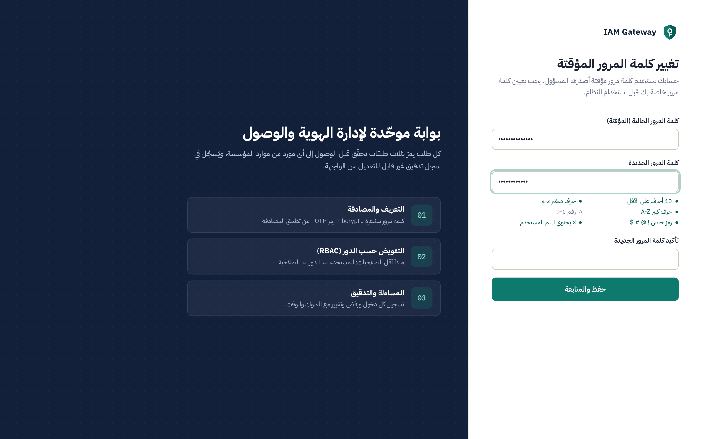

- `shahad.aljanabi` موظفة جديدة أنشأ حسابها المسؤول بكلمة مرور مؤقتة.
- بعد الدخول تُحوَّل إجبارياً لهذه الصفحة، وأي طلب API آخر يُرفض بالرمز `PASSWORD_CHANGE_REQUIRED` حتى تغيّرها.
- **الكود:** `src/middleware/auth.js → requirePasswordChanged`

---

## ب. دورة حياة الهوية (Identity Lifecycle)

### 8. قائمة المستخدمين — كل الهويات وحالاتها

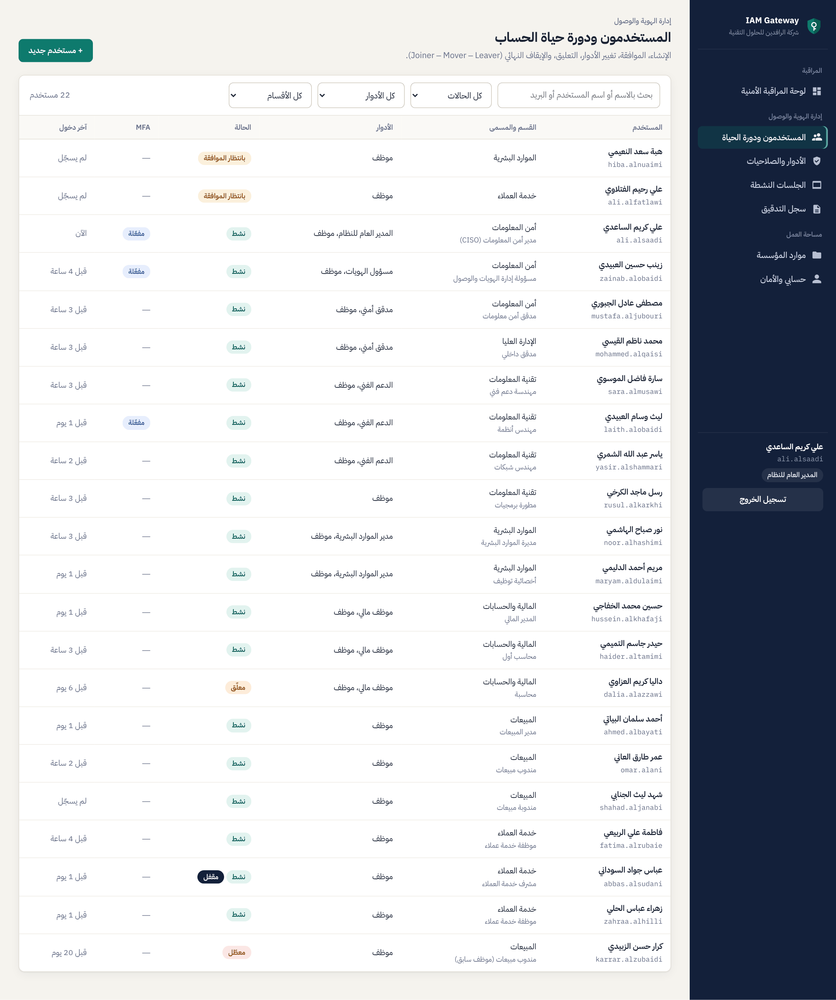

- طلبات «بانتظار الموافقة» تظهر أولاً لتسهيل معالجتها.
- بحث وتصفية حسب الحالة والدور والقسم.
- شارات توضح: الحالة، القفل، تفعيل MFA، آخر دخول.

### 9. الموافقة على حساب جديد (Joiner)

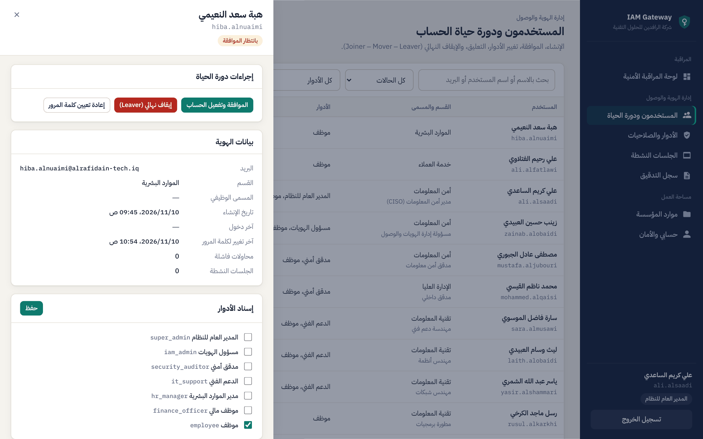

- `hiba.alnuaimi` سجّلت بنفسها، والحساب ينتظر الموافقة.
- زر «الموافقة وتفعيل الحساب» يحوّل الحالة إلى `active` ويسجّل الحدث `user.approve`.
- لوحة «الصلاحيات الفعلية» توضح أنها لا تملك سوى `resources:public:read`.

### 10. حساب مقفل — إجراءات دورة الحياة

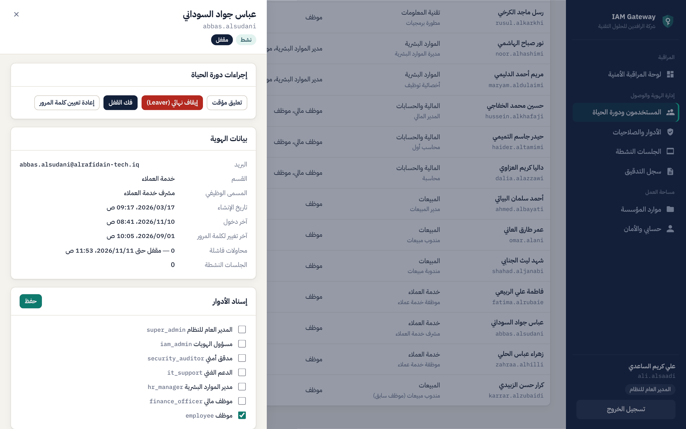

- تفاصيل الهوية: البريد، القسم، تاريخ الإنشاء، آخر دخول، آخر تغيير لكلمة المرور، المحاولات الفاشلة، وقت انتهاء القفل، عدد الجلسات النشطة.
- الإجراءات المتاحة حسب صلاحيات المسؤول: تعليق مؤقت، إيقاف نهائي (Leaver)، فك القفل، إعادة تعيين كلمة المرور.
- إسناد الأدوار بمربعات اختيار (Mover).

### 11–12. إنشاء مستخدم من المسؤول وكلمة المرور المؤقتة

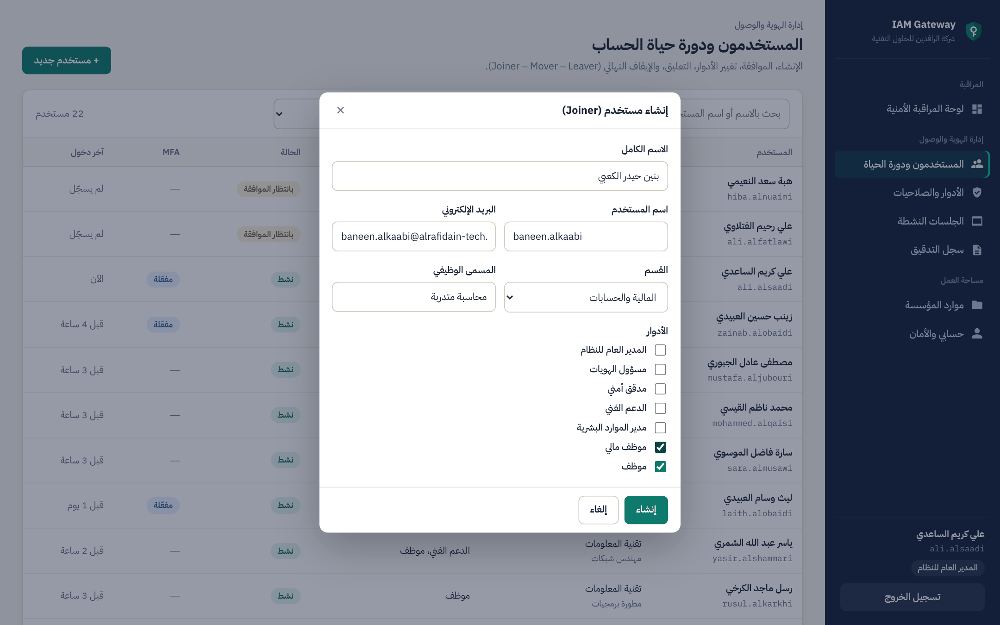

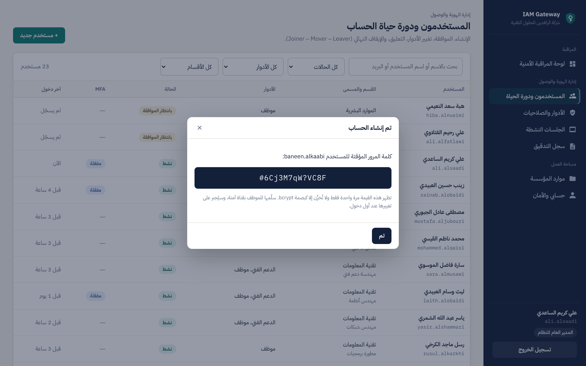

- المسؤول يحدد القسم والأدوار عند الإنشاء (هنا: موظف + موظف مالي).
- يولّد الخادم كلمة مرور مؤقتة قوية (14 حرفاً تستوفي السياسة) تظهر **مرة واحدة** ليسلّمها المسؤول للموظف بقناة آمنة.
- الحساب يُعلَّم `must_change_password` ← الصورة 23.

---

## ج. التفويض (Authorization — RBAC)

### 13. الأدوار والصلاحيات + مصفوفة مراجعة الوصول

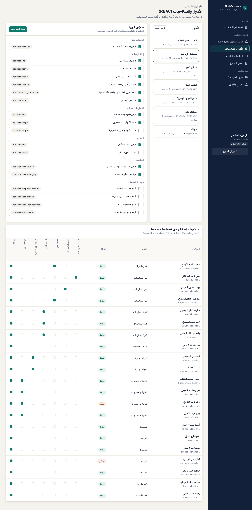

- يسار: الأدوار السبعة مع عدد المستخدمين والصلاحيات.
- وسط: صلاحيات دور «مسؤول الهويات» مجمّعة حسب الفئة، كل صلاحية بصيغة `resource:action`. لاحظ أن `roles:manage` **غير ممنوحة** له (فصل المهام).
- أسفل: **مصفوفة مراجعة الوصول** — كل موظف مقابل كل دور، يستخدمها المدقق للتأكد من عدم وجود صلاحيات زائدة.

### 22. المدقق الأمني — قراءة فقط

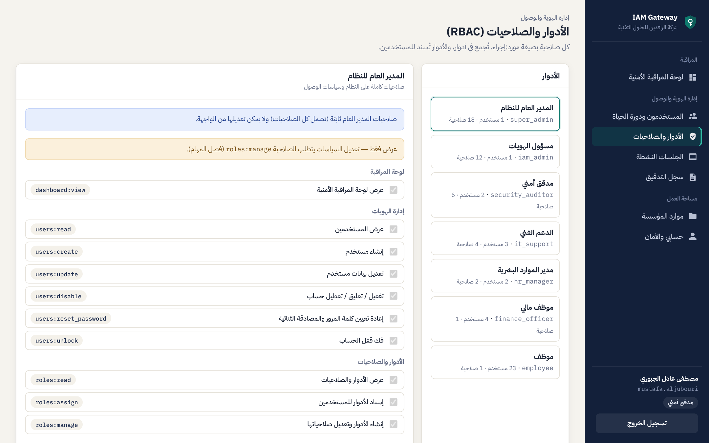

- `mustafa.aljubouri` يرى الأدوار والصلاحيات لكن المربعات **معطّلة** وتظهر رسالة «عرض فقط»، لأن تعديل السياسات يتطلب `roles:manage`.

### 17. الموظف — المستندات العامة مسموحة

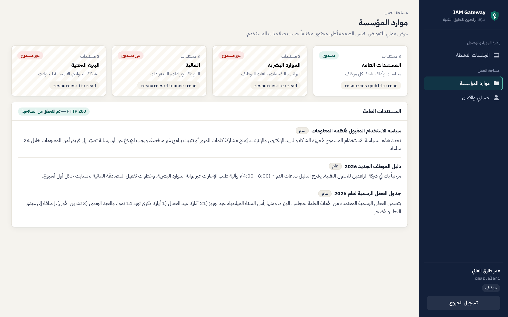

- `omar.alani` يملك دور «موظف» فقط. البطاقات تُظهر لكل قسم الصلاحية المطلوبة وهل يملكها.
- المستندات العامة تُعرض بعد أن تحقق الخادم من `resources:public:read` (HTTP 200).

### 18. الموظف — الملفات المالية مرفوضة (403)

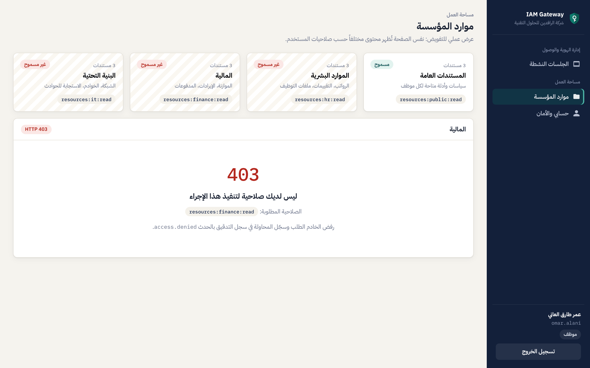

- عند طلب الملفات المالية يرفض **الخادم** الطلب (HTTP 403) ويوضح الصلاحية الناقصة، ويسجّل الحدث `access.denied`.

### 21. الموظف المالي — نفس الصفحة بمحتوى مختلف

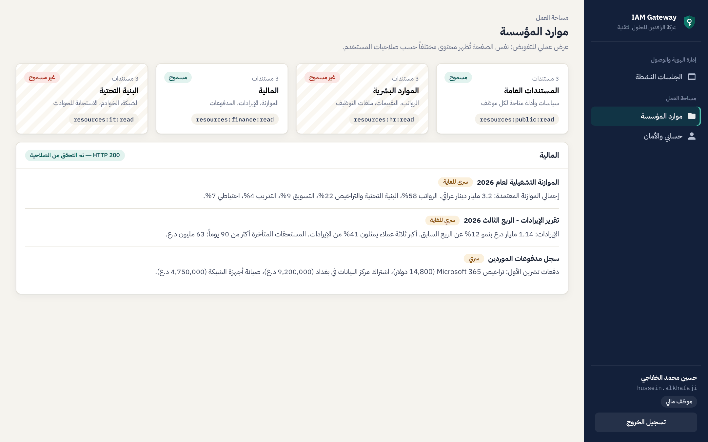

- `hussein.alkhafaji` يملك `finance_officer` فيرى الموازنة وتقرير الإيرادات، لكنه يُرفض في الموارد البشرية والبنية التحتية.
- **نفس الصفحة ونفس الكود** يعطيان نتائج مختلفة حسب الهوية — هذا جوهر التفويض.

### 19. محاولة فتح صفحة إدارية بكتابة الرابط يدوياً

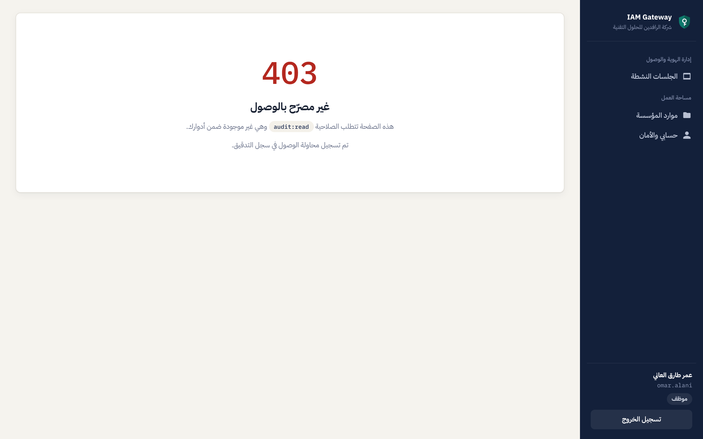

- القائمة الجانبية للموظف لا تحتوي «سجل التدقيق» أصلاً، لكنه كتب `/audit` في المتصفح.
- تظهر صفحة 403، والأهم أن **الخادم** رفض طلب البيانات وسجّل المحاولة. إخفاء الروابط تحسين للتجربة فقط؛ الحماية الحقيقية في الخادم.

---

## د. إدارة الجلسات (Session Management)

### 16. الجلسات النشطة

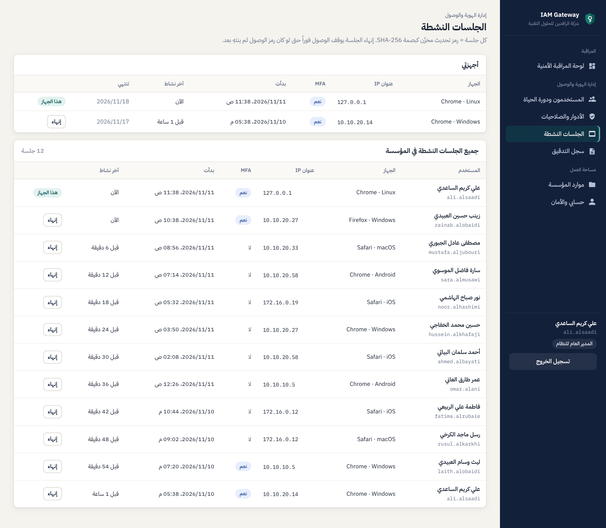

- «أجهزتي»: كل جلسات المستخدم الحالي مع الجهاز وعنوان IP وهل تم التحقق بـ MFA ووقت البدء وآخر نشاط وتاريخ الانتهاء.
- «جميع الجلسات» (للمسؤولين فقط بصلاحية `sessions:read_all`): كل الجلسات في المؤسسة.
- زر «إنهاء» يُلغي الجلسة في قاعدة البيانات، فيرفض الخادم الطلب التالي من ذلك الجهاز فوراً حتى لو كان رمز JWT لم ينتهِ بعد.

---

## هـ. المساءلة والمراقبة (Accountability & Monitoring)

### 7. لوحة المراقبة الأمنية

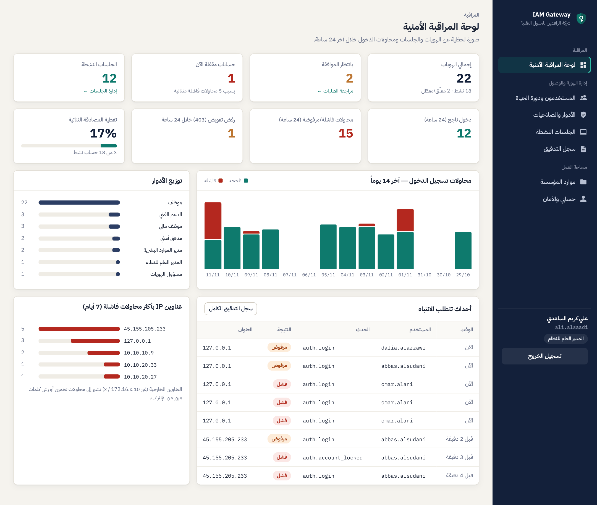

- **بطاقات:** إجمالي الهويات، الطلبات المعلقة، الحسابات المقفلة، الجلسات النشطة، الدخول الناجح والفاشل خلال 24 ساعة، حالات رفض التفويض، نسبة تغطية MFA.
- **رسم بياني** لمحاولات الدخول خلال 14 يوماً (الأحمر = فاشلة) — يظهر يوم هجوم رش كلمات المرور واضحاً.
- **أكثر العناوين فشلاً:** العنوان الخارجي `45.155.205.233` في الصدارة — مؤشر على هجوم من الإنترنت.
- **أحداث تتطلب الانتباه:** آخر حالات الفشل والرفض والتغييرات الإدارية.

### 14. سجل التدقيق

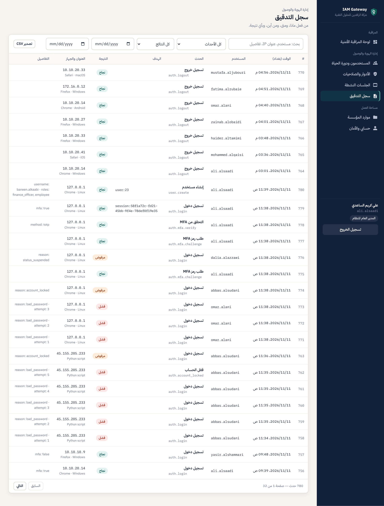

- كل حدث: الرقم، الوقت بتوقيت بغداد، المنفّذ، الحدث (بالعربية والاسم البرمجي)، الهدف، النتيجة، العنوان والجهاز، التفاصيل.
- بحث نصي وتصفية حسب نوع الحدث والنتيجة والفترة الزمنية، مع ترقيم الصفحات.
- زر «تصدير CSV» يظهر فقط لمن يملك `audit:export` (المدير العام والمدقق).

### 15. تصفية الأحداث الفاشلة — التحقيق في هجوم

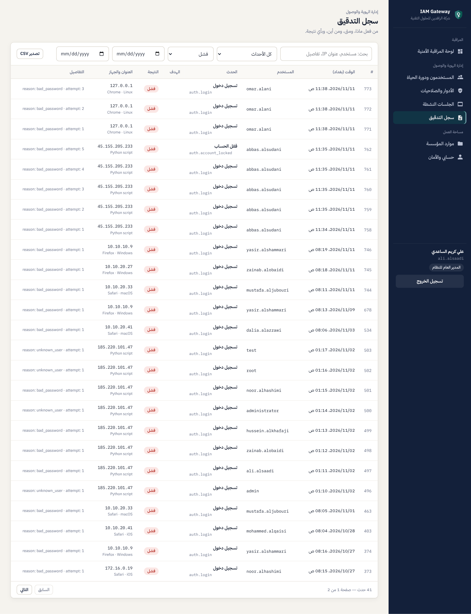

- بعد اختيار «فشل» يظهر الهجومان المحاكيان بوضوح:
  - **هجوم تخمين (Brute Force):** 5 محاولات على `abbas.alsudani` خلال دقيقة من `45.155.205.233` انتهت بالحدث «قفل الحساب».
  - **رش كلمات المرور (Password Spraying):** محاولة واحدة على كل حساب من حسابات المسؤولين وأسماء شائعة (`admin`, `root`, `test`) من عقدة Tor `185.220.101.47` بعد منتصف الليل.
- عمود الجهاز يظهر «Python script» (أداة `python-requests`) وليس متصفحاً — دليل على هجوم آلي، بينما الأخطاء العادية للموظفين من شبكة الشركة الداخلية `10.10.x.x` في أوقات الدوام.

