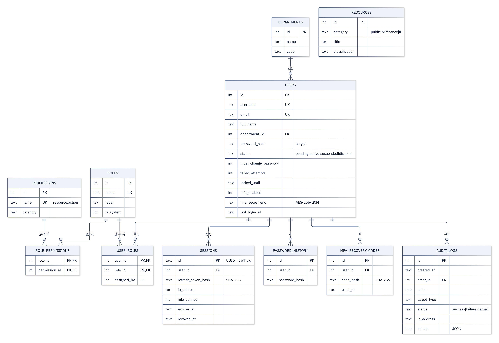

<div dir="rtl">

# تصميم قاعدة البيانات

- **المحرّك:** SQLite عبر الوحدة المدمجة في Node.js (`node:sqlite`) — ملف واحد `data/iam.db`.
- **المخطط:** [`src/db/schema.sql`](../src/db/schema.sql) — 21 جدولاً و11 فهرساً.
- **الإعدادات:** `PRAGMA foreign_keys = ON` (فرض المفاتيح الأجنبية) و`journal_mode = WAL` (قراءة وكتابة متزامنة).
- **الأمان:** كل الاستعلامات **Prepared Statements** بمعاملات مربوطة (`?`) — لا يُدمج أي إدخال من المستخدم في نص SQL، وهذا يمنع حقن SQL. العمليات المتعددة (مثل إنشاء مستخدم + إسناد دوره + سجل كلمة المرور) تتم داخل **معاملة (Transaction)**: تنجح كلها أو تُلغى كلها.



## الجداول

### مجموعة الهوية

#### `departments` — الأقسام
| العمود | النوع | الوصف |
|---|---|---|
| id | INTEGER PK | |
| name | TEXT UNIQUE | اسم القسم بالعربية |
| code | TEXT UNIQUE | رمز مختصر (SEC, IT, HR, FIN …) |

#### `users` — الهويات
| العمود | النوع | الوصف |
|---|---|---|
| id | INTEGER PK | |
| username | TEXT UNIQUE NOCASE | اسم الدخول، فريد دون تمييز حالة الأحرف |
| email | TEXT UNIQUE NOCASE | يمكن الدخول به أيضاً |
| full_name, job_title | TEXT | |
| department_id | FK → departments | |
| password_hash | TEXT | تجزئة **bcrypt** (`$2b$12$...`) |
| status | TEXT CHECK | `pending` · `active` · `suspended` · `disabled` |
| must_change_password | INTEGER | 1 = كلمة مرور مؤقتة |
| password_changed_at | TEXT | |
| failed_attempts | INTEGER | عدّاد المحاولات الفاشلة المتتالية |
| locked_until | TEXT | وقت انتهاء القفل المؤقت |
| mfa_enabled | INTEGER | |
| mfa_secret_enc | TEXT | سر TOTP مشفّر **AES-256-GCM** بصيغة `iv.tag.ciphertext` |
| last_login_at | TEXT | |
| created_by | FK → users | من أنشأ الحساب |
| created_at, updated_at | TEXT | |

#### `password_history` — سجل كلمات المرور
آخر 5 تجزئات لكل مستخدم لمنع إعادة الاستخدام.

### مجموعة التفويض (RBAC)

#### `roles`
| العمود | الوصف |
|---|---|
| name | الاسم البرمجي (`iam_admin`) |
| label | الاسم المعروض (مسؤول الهويات) |
| description | |
| is_system | 1 = دور أساسي لا يُحذف |

#### `permissions`
| العمود | الوصف |
|---|---|
| name | بصيغة `resource:action` مثل `users:create` |
| label | وصف عربي |
| category | فئة للعرض في الواجهة |

#### `role_permissions` و `user_roles`
جداول ربط كثير-إلى-كثير، المفتاح الأساسي مركّب `(role_id, permission_id)` و`(user_id, role_id)`. `user_roles` تحفظ أيضاً **من أسند الدور** (`assigned_by`) و**متى**، لأغراض التدقيق. الحذف المتتالي `ON DELETE CASCADE` يضمن عدم بقاء روابط يتيمة.

### مجموعة المصادقة

#### `sessions`
| العمود | الوصف |
|---|---|
| id | UUID عشوائي، وهو نفسه `sid` داخل JWT |
| user_id | |
| refresh_token_hash | **SHA-256** لرمز التحديث (الرمز نفسه لا يُخزّن) |
| ip_address, user_agent | الجهاز |
| mfa_verified | هل تم الدخول بعامل ثانٍ |
| created_at, last_used_at, expires_at | |
| revoked_at, revoke_reason | `logout` · `admin_revoked` · `password_changed` · `refresh_token_reuse` · `account_disabled` … |

#### `mfa_recovery_codes`
8 رموز لكل مستخدم، مخزّنة كبصمات SHA-256، و`used_at` يجعل كل رمز صالحاً لمرة واحدة.

### مجموعة المساءلة

#### `audit_logs`
| العمود | الوصف |
|---|---|
| created_at | UTC |
| actor_id, actor_username | المنفّذ (الاسم يُحفظ نصاً حتى لو حُذف الحساب لاحقاً) |
| action | نوع الحدث (`auth.login`, `access.denied`, `user.roles.update` …) |
| target_type, target_id | الهدف (`user:13`, `role:2`, `session:…`, `endpoint:GET /api/audit/`) |
| status | `success` · `failure` · `denied` |
| ip_address, user_agent | |
| details | JSON بالتفاصيل (السبب، ما أُضيف/حُذف، رقم المحاولة …) |

فهارس على `created_at`, `actor_id`, `action` لتسريع البحث والتصفية.

### مجموعة المحتوى المحمي (وحدات الأعمال)

كل جدول من هذه الجداول يحتوي **عمود ملكية** يربطه بمستخدم، وهو ما تعتمد عليه قواعد النطاق («بياناتي» / «قسمي») وقواعد فصل المهام («لا تعتمد ما أنشأته»).

| الجدول | المحتوى | عمود الملكية | قواعد التفويض المرتبطة |
|---|---|---|---|
| `employee_profiles` | الرقم الوظيفي، الهاتف، تاريخ التعيين، الهوية الوطنية، العنوان، العقد، الدرجة، **الراتب الأساسي، المخصصات، IBAN**، رصيد الإجازة | `user_id` (1:1 مع users) | `hr_records:read` للملف، و`salary:read` للحقول المالية |
| `announcements` | العنوان، النص، **القسم المستهدف** (NULL = الجميع)، التثبيت | `created_by` | الإعلان الموجّه لا يراه إلا قسمه |
| `leave_requests` | النوع، من/إلى، أيام العمل، السبب، الحالة، المراجِع وملاحظته | `user_id`, `reviewed_by` | own/department/all + لا اعتماد ذاتي |
| `payroll_runs` | الشهر، الحالة (draft/approved/paid)، المُعِدّ، المعتمِد | `prepared_by`, `approved_by` | المُعِدّ ≠ المعتمِد |
| `payslips` | الأساسي، المخصصات، الإضافي، ضمان 5%، الضريبة، الصافي | `user_id` | `payroll:read:own` يرى قسائمه فقط |
| `invoices` | رقم الفاتورة، المورد، الوصف، **المبلغ بالدينار**، الاستحقاق، الحالة | `created_by`, `approved_by` | المُدخل ≠ المعتمِد + حد 10 ملايين |
| `expense_claims` | الفئة، المبلغ، الوصف، التاريخ، الحالة | `user_id`, `reviewed_by` | own/all + لا اعتماد ذاتي |
| `customers` | الاسم، القطاع، المدينة، جهة الاتصال | `account_manager_id` | قراءة للمبيعات وخدمة العملاء، الإضافة للمدير |
| `deals` | العميل، العنوان، القيمة، المرحلة، الإغلاق المتوقع | `owner_id` | own/all + التعديل للمالك + إعادة الإسناد للمدير |
| `tickets` | الرقم، العميل، الموضوع، الأولوية، الحالة | `assigned_to`, `created_by` | المعالجة للمسند إليه، الإسناد والإغلاق للمشرف |
| `assets` | الوسم، النوع، الطراز، الرقم التسلسلي، الحالة، الموقع، الضمان | `assigned_to` | own/all + كشف أجهزة الموظفين المعطّلين |
| `resources` | مستندات في 4 فئات (`public`, `hr`, `finance`, `it`) | — | صلاحية قراءة لكل فئة |

**كيف يُطبَّق النطاق في SQL؟** الدالة `scopeWhere()` في `src/routes/apps/_helpers.js` تضيف الشرط إلى الاستعلام نفسه، فلا تُقرأ الصفوف غير المسموحة من القاعدة أصلاً:

</div>

```sql
-- leave:read:own
... WHERE l.user_id = ?            -- رقم المستخدم الحالي
-- leave:read:department
... WHERE u.department_id = ?      -- قسم المستخدم الحالي
-- leave:read:all
... WHERE 1 = 1
```

<div dir="rtl">

## لماذا لا تُخزّن الأسرار بشكل صريح؟

| القيمة | طريقة التخزين | السبب |
|---|---|---|
| كلمة المرور | bcrypt (تجزئة بطيئة + ملح) | لا حاجة لاسترجاعها أبداً؛ المقارنة تكفي |
| رمز التحديث | SHA-256 | قيمة عشوائية طويلة (256 بت) فلا تحتاج تجزئة بطيئة |
| رموز الاسترداد | SHA-256 | كذلك |
| سر TOTP | AES-256-GCM | الخادم **يحتاج** قراءته لحساب الرمز، فيجب أن يكون قابلاً لفك التشفير |

لو سُرّب ملف `iam.db` كاملاً، لن يستطيع المهاجم: معرفة كلمات المرور، ولا استخدام الجلسات، ولا توليد رموز MFA (المفتاح في `data/secrets.json` أو متغير البيئة وليس في القاعدة).

## البيانات التجريبية (`src/db/seed.js`)

| البيان | العدد |
|---|---|
| الأقسام | 7 |
| الموظفون | 23 (19 نشط، 2 بانتظار الموافقة، 1 معلّق، 1 معطّل) |
| الأدوار / الصلاحيات | 15 / 55 |
| أحداث التدقيق | أكثر من 860 خلال 30 يوماً |
| الجلسات النشطة | 11 |
| ملفات الموظفين | 23 (رواتب من 1,100,000 إلى 7,500,000 د.ع) |
| الإعلانات | 9 (6 عامة، 3 موجّهة لأقسام) |
| طلبات الإجازة | ~40 |
| مسيّرات الرواتب / القسائم | 4 / 80 |
| فواتير الموردين | 37 |
| طلبات المصروفات | 32 |
| العملاء / الصفقات | 18 / 32 |
| تذاكر الدعم | 40 |
| الأجهزة والأصول | 51 |
| المستندات المحمية | 12 |

الهويات والسجل في `seed.js` ومحتوى الأعمال في `seed-business.js`، وكلها تُولَّد بمولّد أرقام شبه عشوائي **ثابت البذرة** فيعطي النتائج نفسها في كل مرة، ويحاكي: الدخول اليومي في أوقات الدوام مع عطلة الجمعة والسبت، أخطاء كتابة عرضية، أحداث إدارية، رفض صلاحيات، وثلاث حوادث أمنية (رش كلمات مرور، تخمين أدى إلى قفل، سرقة رمز تحديث).

لإعادة البيانات إلى حالتها الأصلية: `npm run seed`

## استعلامات مفيدة للعرض أمام المشرف

</div>

```sql
-- الصلاحيات الفعلية لمستخدم
SELECT DISTINCT p.name FROM permissions p
JOIN role_permissions rp ON rp.permission_id = p.id
JOIN user_roles ur ON ur.role_id = rp.role_id
JOIN users u ON u.id = ur.user_id
WHERE u.username = 'zainab.alobaidi';

-- إثبات أن كلمات المرور غير مخزّنة كنص
SELECT username, substr(password_hash, 1, 29) || '…' FROM users LIMIT 3;

-- من يملك صلاحية اعتماد الفواتير بلا حد؟
SELECT u.full_name FROM users u
JOIN user_roles ur ON ur.user_id = u.id
JOIN role_permissions rp ON rp.role_id = ur.role_id
JOIN permissions p ON p.id = rp.permission_id
WHERE p.name = 'invoices:approve_unlimited';

-- أجهزة ما زالت لدى موظفين معطّلين (Leaver غير مكتمل)
SELECT a.tag, a.model, u.full_name FROM assets a JOIN users u ON u.id = a.assigned_to
WHERE u.status = 'disabled';

-- أكثر العناوين فشلاً في الدخول
SELECT ip_address, COUNT(*) FROM audit_logs
WHERE action LIKE 'auth.%' AND status = 'failure'
GROUP BY ip_address ORDER BY 2 DESC LIMIT 5;
```

<div dir="rtl">

يمكن فتح الملف `data/iam.db` بأداة مجانية مثل **DB Browser for SQLite** لعرض الجداول.

</div>
