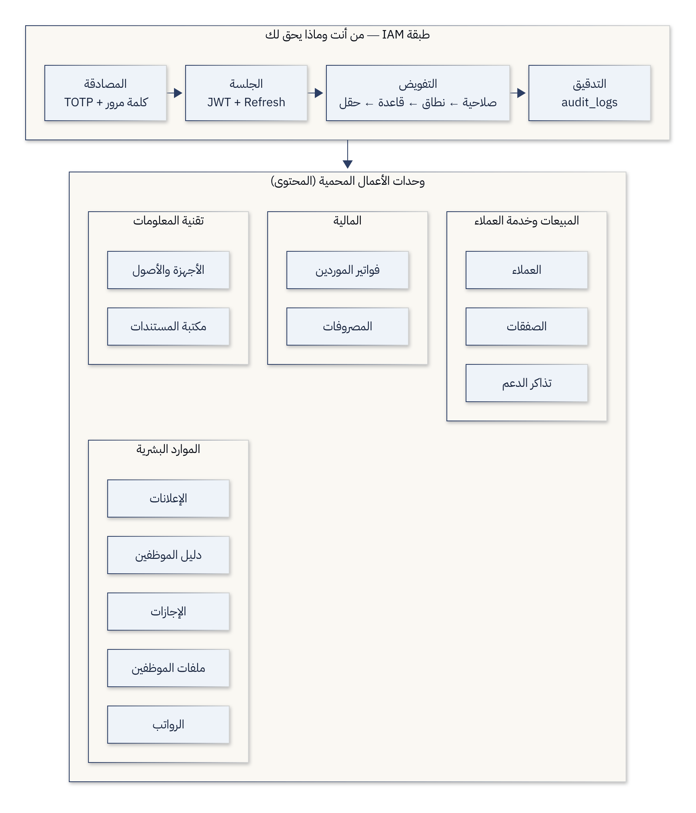
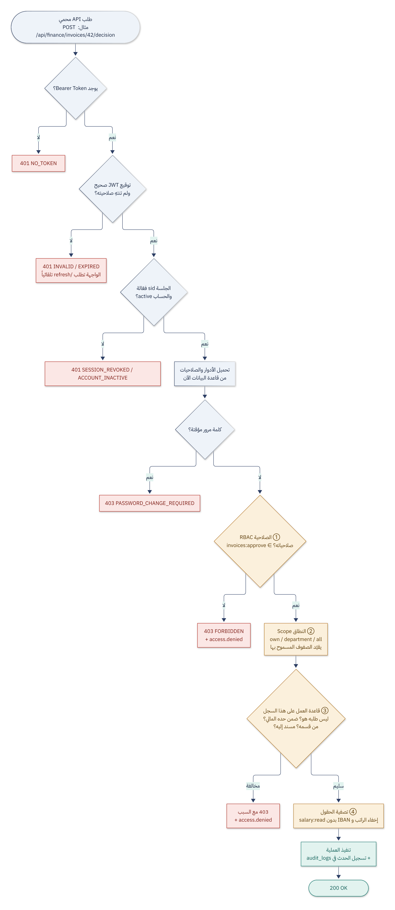
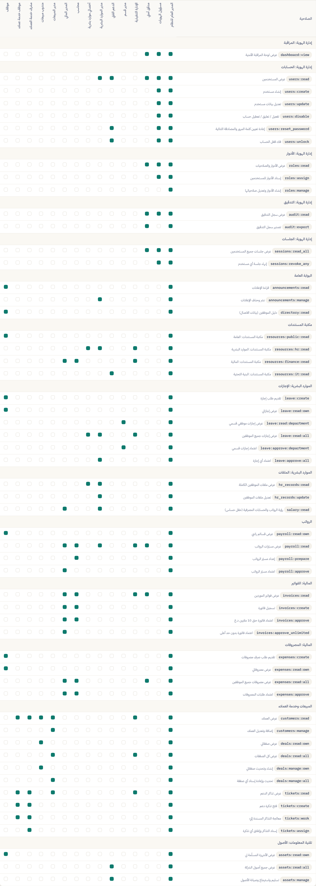

# وحدات الأعمال: المحتوى الذي يحميه نظام IAM

نظام إدارة الهوية لا قيمة له إذا لم يكن هناك ما يحميه. لذلك يحتوي المشروع على **بوابة موظفين متكاملة** لشركة الرافدين للحلول التقنية، فيها **12 وحدة أعمال** ببيانات حقيقية، وكل زر وكل سجل وكل حقل فيها تتحكم به الأدوار والصلاحيات.

---

## 1. طبقات التفويض الأربع

لا يكفي أن نسأل «هل يملك المستخدم صلاحية الإجازات؟». في المؤسسات الحقيقية يقرر النظام على أربعة مستويات، وكلها مطبّقة في الخادم (`src/routes/apps/_helpers.js`):

| الطبقة | السؤال | مثال من المشروع |
|---|---|---|
| ① **الصلاحية (RBAC)** | هل يحق له هذا **الإجراء** أصلاً؟ | المندوب لا يملك `invoices:read` ← لا يرى صفحة الفواتير ويُرفض طلبه 403 |
| ② **النطاق (Scope)** | **أي سجلات** يراها؟ | `leave:read:own` إجازاتي فقط · `leave:read:department` قسمي · `leave:read:all` الجميع |
| ③ **قاعدة العمل (Business Rule)** | هل يحق له هذا **السجل بعينه**؟ | لا يعتمد طلبه بنفسه · المحاسب لا يعتمد فاتورة فوق 10 ملايين · المندوب لا يعدّل صفقة زميله |
| ④ **الحقل (Field-level)** | **أي أعمدة** يراها من السجل؟ | أخصائية الموارد البشرية ترى ملف الموظف لكن الراتب و IBAN محجوبان (`salary:read`) |

الطبقة الثالثة تجعل النموذج أقرب إلى **ABAC** (التحكم المبني على الخصائص): القرار يعتمد على خصائص السجل (المبلغ، المالك، القسم، الحالة) وليس على الدور فقط.

**الخادم هو من يقرر الأزرار:** كل سجل يعود من الـ API ومعه حقل `_actions` (مثل `['approve','reject']`) محسوب بنفس القواعد، ومعه `_note` يشرح سبب المنع (مثل «لا يمكنك اعتماد فاتورة سجّلتها بنفسك»). الواجهة تعرض فقط ما يسمح به الخادم، ومع ذلك يُعاد التحقق عند تنفيذ أي إجراء، وأي محاولة مخالفة تُرفض بـ 403 وتُسجّل في سجل التدقيق.

**كل صفحة تعرض الصلاحيات التي تحكمها:** شريط «الصلاحيات التي تحكم هذه الصفحة» أعلى كل وحدة يوضح بعلامة ✓ أو ✗ ما يملكه المستخدم الحالي، فيرى المشرف مباشرة لماذا تظهر الصفحة بهذا الشكل.

---

## 2. الوحدات

| المجال | الوحدة | الصفحة | المسار في الـ API | البيانات التجريبية |
|---|---|---|---|---|
| البوابة | الرئيسية (مهامي) | `/home` | `GET /api/portal/home` | محسوبة لكل مستخدم |
| البوابة | الإعلانات | `/announcements` | `/api/hr/announcements` | 9 إعلانات (6 عامة، 3 موجّهة لأقسام) |
| البوابة | دليل الموظفين | `/directory` | `/api/hr/directory` | 18 موظفاً نشطاً |
| الموارد البشرية | الإجازات | `/leave` | `/api/hr/leave` | ~40 طلباً |
| الموارد البشرية | ملفات الموظفين | `/hr-records` | `/api/hr/records` | 23 ملفاً برواتب ومعلومات شخصية |
| الموارد البشرية | الرواتب | `/payroll` | `/api/hr/payroll/*` | 4 مسيّرات (آب – تشرين الثاني 2026)، 80 قسيمة |
| المالية | فواتير الموردين | `/invoices` | `/api/finance/invoices` | 37 فاتورة بالدينار العراقي |
| المالية | المصروفات | `/expenses` | `/api/finance/expenses` | 32 طلب صرف |
| المبيعات | العملاء | `/customers` | `/api/ops/customers` | 18 عميلاً في 10 محافظات |
| المبيعات | الصفقات | `/deals` | `/api/ops/deals` | 32 صفقة |
| خدمة العملاء | تذاكر الدعم | `/tickets` | `/api/ops/tickets` | 40 تذكرة |
| تقنية المعلومات | الأجهزة والأصول | `/assets` | `/api/ops/assets` | 51 جهازاً (حاسبات، خوادم، شبكات) |
| تقنية المعلومات | مكتبة المستندات | `/resources` | `/api/dashboard/resources` | 12 مستنداً مصنفاً |

---

## 3. من يستطيع ماذا؟ (مصفوفة الوحدات × الأدوار)

`R` = قراءة · `R*` = قراءة بنطاق محدود (بياناتي/قسمي) · `W` = إنشاء/تعديل · `A` = اعتماد · `—` = لا وصول

| الوحدة | موظف | مندوب مبيعات | مدير مبيعات | مدير قسم | خدمة عملاء | مشرف خدمة | محاسب | مدير مالي | أخصائي HR | مدير HR | دعم فني | الإدارة التنفيذية | مدقق |
|---|---|---|---|---|---|---|---|---|---|---|---|---|---|
| الإعلانات | R (العامة + قسمه) | R | R | R | R | R | R | R | R | **W** | R | R | R |
| دليل الموظفين | R | R | R | R | R | R | R | R | R | R | R | R | R |
| الإجازات | R* بياناتي + W | ← | ← | **R* قسمي + A قسمي** | ← | ← | ← | ← | R الكل | **R + A الكل** | ← | R الكل | ← |
| ملفات الموظفين | — | — | — | — | — | — | — | — | R بدون الراتب | **R + W + الراتب** | — | — | — |
| الرواتب | قسائمي | ← | ← | ← | ← | ← | R + إعداد | **R + A** | ← | R | ← | R | R |
| الفواتير | — | — | — | — | — | — | R + W + A ≤ 10M | R + W + **A بلا حد** | — | — | — | R | R |
| المصروفات | R* بياناتي + W | ← | ← | ← | ← | ← | R الكل + A | R الكل + A | ← | ← | ← | ← | R الكل |
| العملاء | — | R | **R + W** | — | R | R | — | — | — | — | — | R | — |
| الصفقات | — | **R* صفقاتي + W** | **R الكل + W + إعادة إسناد** | — | — | — | — | — | — | — | — | R الكل | — |
| التذاكر | — | — | R | — | R + W المسندة إليه | **R + W + إسناد + إغلاق** | — | — | — | — | — | R | — |
| الأجهزة | R* أجهزتي | ← | ← | ← | ← | ← | ← | ← | ← | ← | **R الكل + W** | ← | ← |

`←` = نفس صلاحيات الموظف الأساسية (كل مستخدم يملك دور `employee` إضافة لدوره الوظيفي). المصفوفة الكاملة بالصلاحيات الـ 55 تظهر في صفحة «الأدوار والصلاحيات».

---

## 4. قواعد العمل المطبّقة (Business Rules)

| الوحدة | القاعدة | لماذا؟ | مكانها |
|---|---|---|---|
| الإجازات | لا يعتمد أحد طلب إجازته بنفسه | فصل المهام | `leaveDecisionBlock()` في `hr.js` |
| الإجازات | مدير القسم يعتمد طلبات قسمه فقط | أقل الصلاحيات | `leaveDecisionBlock()` |
| الإجازات | لا يُقدَّم طلب سنوي يتجاوز الرصيد | سلامة البيانات | `leaveBalance()` |
| الإجازات | الموظف يلغي طلبه هو فقط وما دام قيد الانتظار | ملكية السجل | `POST /leave/:id/cancel` |
| ملفات الموظفين | الراتب والمخصصات و IBAN تتطلب `salary:read` قراءةً وكتابةً | أمن على مستوى الحقل | `shapeRecord()` و `PATCH /records/:id` |
| ملفات الموظفين | كل اطلاع على ملف موظف يُسجَّل (`hr_record.view`) | مساءلة الوصول للبيانات الحساسة | `GET /records/:id` |
| الرواتب | من أعدّ المسيّر لا يعتمده | Maker–Checker | `runActions()` |
| الرواتب | الموظف يرى قسائمه المعتمدة فقط | أقل الصلاحيات | `GET /payroll/mine` |
| الفواتير | من سجّل الفاتورة لا يعتمدها | Maker–Checker | `invoiceBlock()` في `finance.js` |
| الفواتير | المحاسب يعتمد حتى 10,000,000 د.ع، وما فوقها للمدير المالي | حدود صلاحية مالية (Approval Limits) | `invoiceBlock()` |
| المصروفات | لا يعتمد أحد مصروفاته بنفسه | فصل المهام | `expenseBlock()` |
| الصفقات | المندوب يرى ويعدّل صفقاته فقط | ملكية السجل | `dealEdit()` في `operations.js` |
| الصفقات | إعادة إسناد الصفقة لمدير المبيعات فقط | فصل المهام | `PATCH /deals/:id` |
| التذاكر | الموظف يعالج التذاكر المسندة إليه فقط، أو يستلم غير المسندة | ملكية السجل | `ticketActions()` |
| التذاكر | الإسناد والإغلاق للمشرف فقط | فصل المهام | `ticketActions()` |
| الإعلانات | الإعلان الموجّه لقسم لا يراه غيره | خاصية الجمهور (ABAC) | `GET /announcements` |
| الأجهزة | الأجهزة المسلّمة لموظف معطّل تُعلَّم «يجب استرجاعه» | إكمال دورة Leaver | `GET /assets` |

---

## 5. سيناريوهات جاهزة للعرض أمام المشرف

كلمة المرور لكل الحسابات `Rafidain@2026` (الحسابات المعلّمة بـ MFA تحتاج `npm run totp`).

### السيناريو 1 — نفس الصفحة، ثلاث نتائج مختلفة (النطاق)
1. ادخل بـ `omar.alani` ← **الإجازات**: يرى طلباته فقط، وتبويبا «قسمي» و«كل المؤسسة» معطّلان.
2. ادخل بـ `ahmed.albayati` (مدير المبيعات) ← يرى طلبات قسم المبيعات ويستطيع اعتماد طلب عمر، لكن طلبه هو يظهر عليه «🔒 لا يمكنك اعتماد طلب إجازتك بنفسك».
3. ادخل بـ `noor.alhashimi` (مديرة HR) ← ترى كل المؤسسة وتعتمد طلب أحمد.

### السيناريو 2 — فصل المهام وحدود الاعتماد المالي
1. ادخل بـ `haider.altamimi` (محاسب) ← **فواتير الموردين** ← قيد الانتظار:
   - الفواتير التي سجّلها هو: لا زر اعتماد، والسبب «من يُدخل لا يعتمد».
   - فاتورة الخادم بـ 42,750,000 د.ع: «يتجاوز حد اعتمادك — يتطلب المدير المالي».
   - فواتير زميلته داليا تحت 10 ملايين: يستطيع اعتمادها.
2. ادخل بـ `hussein.alkhafaji` (المدير المالي) ← يعتمد فاتورة الخادم.
3. **الرواتب**: حيدر أعدّ مسيّر تشرين الثاني ولا يستطيع اعتماده، وحسين يعتمده.

### السيناريو 3 — أمن على مستوى الحقل
1. `maryam.aldulaimi` ← **ملفات الموظفين**: الرواتب و IBAN محجوبة 🔒.
2. `noor.alhashimi` ← نفس الصفحة: الرواتب ظاهرة.
3. `omar.alani` ← نفس الرابط: 403.

### السيناريو 4 — ملكية السجل
1. `omar.alani` ← **الصفقات**: صفقاته فقط ويعدّل مرحلتها.
2. `ahmed.albayati` ← كل الصفقات + إعادة إسناد صفقات `karrar.alzubaidi` (موظف سابق) إلى مندوب آخر.

### السيناريو 5 — إكمال دورة حياة الموظف المغادر
1. `sara.almusawi` (دعم فني) ← **الأجهزة** ← كل المؤسسة: أول صف باللون الأحمر «يجب استرجاعه من موظف سابق» (حاسبة كرار).
2. **العملاء**: بعض العملاء مدير حسابهم «موظف سابق» ← يحتاجون إعادة إسناد.

### السيناريو 6 — الرئيسية تختلف لكل شخص
قارن صفحة **الرئيسية** بين `omar.alani` و`hussein.alkhafaji`: قسم «بانتظارك» يحسب المهام بنفس قواعد الاعتماد، و«تطبيقات المؤسسة» تُظهر المقفل منها.

---

## 6. ما يُسجَّل في التدقيق من وحدات الأعمال

`leave.request` · `leave.approve` · `leave.reject` · `leave.cancel` · `hr_record.view` · `hr_record.update` · `payroll.view` · `payroll.approve` · `invoice.create` · `invoice.approve` · `invoice.reject` · `expense.submit` · `expense.approve` · `expense.reject` · `customer.create` · `deal.create` · `deal.update` · `ticket.create` · `ticket.take` · `ticket.start` · `ticket.resolve` · `ticket.close` · `ticket.assign` · `asset.update` · `announcement.create` · `announcement.delete` — إضافة إلى `access.denied` مع **سبب الرفض** لكل مخالفة قاعدة عمل.

